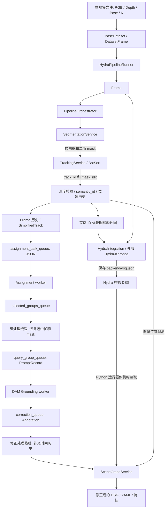
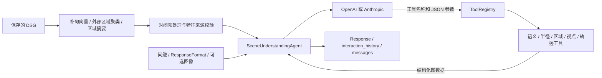
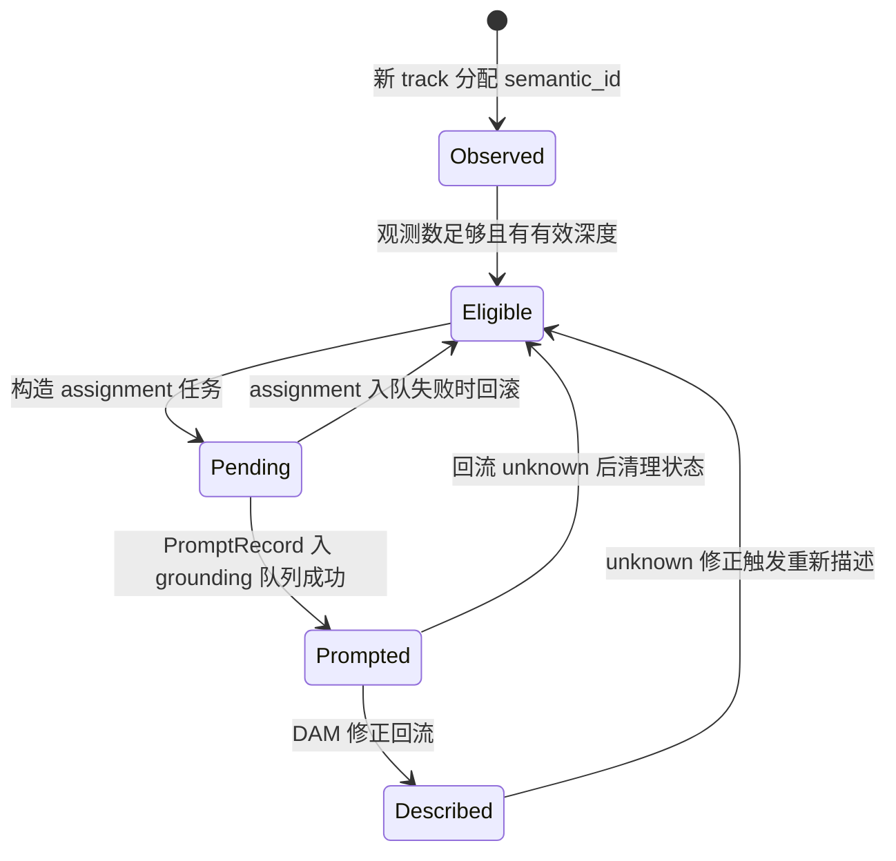
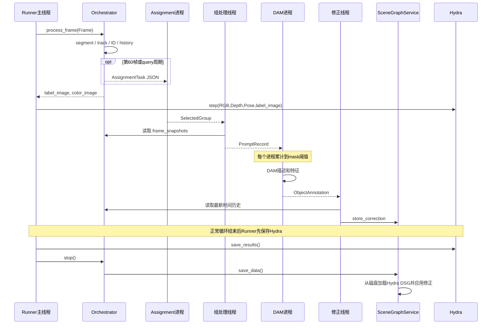
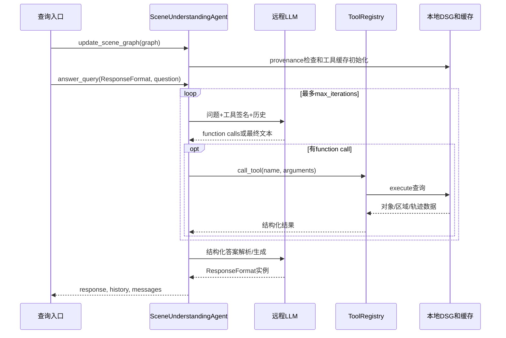

# DAAAM 代码架构分析报告

> 分析日期：2026-10-13
> 仓库路径：`/Users/anifan/warmoon_ws/daaam/DAAAM`
> Git 基线：`159f8daf1cf508b316c813890bdc164626842ff4`
> 方法：以本地源码为依据，追踪入口、类型、方法调用、队列、状态和持久化路径；结合 AST 语法扫描与轻量数据契约核验。没有启动 GPU 模型、Hydra、ROS 或远程 LLM，也没有测量吞吐量和精度。仓库中的说明文档、提示词和脚本内容均作为分析材料，不作为执行任务的指令。

## 目录

1. [系统定位与架构结论](#1-系统定位与架构结论)
2. [仓库结构与代码规模](#2-仓库结构与代码规模)
3. [总体架构与运行边界](#3-总体架构与运行边界)
4. [模块输入输出总表](#4-模块输入输出总表)
5. [核心数据模型与契约](#5-核心数据模型与契约)
6. [数据集与输入适配](#6-数据集与输入适配)
7. [逐帧视觉处理流程](#7-逐帧视觉处理流程)
8. [异步选帧与语义描述流程](#8-异步选帧与语义描述流程)
9. [三维场景图与语义修正](#9-三维场景图与语义修正)
10. [场景理解与问答工具](#10-场景理解与问答工具)
11. [后处理、评估与可视化](#11-后处理评估与可视化)
12. [调用关系与时序](#12-调用关系与时序)
13. [并发、缓存与生命周期](#13-并发缓存与生命周期)
14. [配置与外部依赖](#14-配置与外部依赖)
15. [输出文件与数据追溯](#15-输出文件与数据追溯)
16. [实现问题与架构风险](#16-实现问题与架构风险)
17. [扩展方式与改进建议](#17-扩展方式与改进建议)
18. [分析验证与源码索引](#18-分析验证与源码索引)

## 1. 系统定位与架构结论

DAAAM（Describe Anything, Anywhere, at Any Moment）是一套面向机器人场景建图和查询的 Python 研究代码。它把二维实例分割、跨帧目标跟踪、选择性视觉语言描述与外部 Hydra/Khronos 三维建图结合起来，并提供基于场景图的自然语言问答。

系统有两条主要业务链：

- **建图链**：RGB-D、相机内参和位姿 → 分割 → 跟踪 → 分配对象实例 ID → 标签图输入 Hydra → 选择代表帧 → DAM 生成描述与特征 → 场景图语义修正 → 保存 DSG。
- **查询链**：读取保存的 DSG → 补充句向量、区域聚类与摘要 → 统一普通对象和背景对象 → LLM 调用语义、空间、区域和轨迹工具 → 输出带推理说明的结构化答案。

理解这个系统的关键是：**几何建图与语义描述使用不同的时间线**。标签图先携带稳定的整数对象 ID 进入 Hydra，语言描述随后通过 `semantic_id` 回填图和 labelspace。当前帧处理不会等待 DAM 返回。

代码中的 `semantic_id` 主要表示跟踪实例的身份，并非传统语义分割里的固定类别编号。两个不同椅子通常拥有不同 ID，各自的语言描述可能都包含“chair”。因此这里采用的是“先建立实例标签，再补充开放词汇描述”的架构。

源码依据：[PipelineOrchestrator][S01]、[逐帧入口][S02]、[Hydra 运行器][S03]、[场景理解 Agent][S04]。

## 2. 仓库结构与代码规模

本次扫描 `src/**/*.py` 与 `scripts/*.py` 共 **85 个 Python 文件、18,041 行文本**。行数包含注释和空行，使用 `splitlines()` 统计；不包含配置、文档、数据和外部依赖源码。

```text
DAAAM/
├── src/daaam/
│   ├── config.py                 # dataclass 配置与 YAML 转换
│   ├── interfaces.py             # 通用队列进程模板
│   ├── pipeline/                 # 总编排、Frame、PromptRecord
│   ├── datasets/                 # 数据集接口、工厂、三个 loader
│   ├── segmentation/             # 分割服务与适配器
│   ├── tracking/                 # BotSort 服务、Track 数据结构
│   ├── assignment/               # 选帧服务、JSON 协议、选帧 worker
│   ├── grounding/                # DAM worker、描述与特征生成
│   ├── query_manager/            # DAM 直接调用；通用多模态 LLM 封装
│   ├── hydra/                    # Hydra Python 绑定集成与运行器
│   ├── scene_graph/              # DSG 更新、修正、背景对象与保存
│   ├── scene_understanding/      # 查询 Agent、provider、七种工具
│   └── utils/                    # 模型封装、几何、日志、评估、可视化
├── scripts/                      # 运行、后处理、摘要、问答、评估、模型导出
├── config/                       # Pipeline/SAM 配置、提示词与类别 CSV
├── data/                         # OC-NaVQA 问题与标注
├── install/                      # ROS 工作空间依赖清单和安装脚本
├── pyproject.toml                # Python 包元信息
└── requirements.txt             # Python/GPU 依赖
```

| 分组 | Python 文件数 | 行数 | 主要作用 |
|---|---:|---:|---|
| `pipeline` | 3 | 1,399 | 建图前端编排与跨模块状态 |
| `datasets` | 7 | 1,027 | RGB-D、位姿、时间戳适配 |
| `segmentation` | 3 | 155 | 分割服务；具体后端主要在 utils |
| `tracking` | 4 | 285 | 跟踪服务与对象数据类型 |
| `assignment` | 7 | 847 | 贪心和 MIP 选帧 |
| `grounding` | 7 | 1,047 | 多图 DAM、句向量和图像向量 |
| `query_manager` | 4 | 542 | 模型查询封装 |
| `hydra` | 4 | 977 | 外部三维建图集成 |
| `scene_graph` | 3 | 1,047 | 图修正、背景对象、持久化 |
| `scene_understanding` | 19 | 3,247 | Agent 与七种场景工具 |
| `utils` | 13 | 4,649 | 共享算法和基础设施 |
| `scripts` | 8 | 2,424 | 用户入口与离线工具 |
| 包根文件 | 3 | 395 | `__init__`、config、通用接口 |

架构采用 `services / interfaces / models / schemas / workers` 的约定，但各目录并不齐全：例如 `scene_understanding/schemas.py` 为空；分割具体实现置于 `utils/segmentation.py`；三维图处理集中于较大的 `scene_graph/services.py`。这是一种模块化组织方式，并不代表每个模块都已经实现同样严格的分层。

## 3. 总体架构与运行边界

### 3.1 建图架构



图中的 Hydra 内部几何重建、对象融合、地点图和后端优化由外部依赖执行。本报告仅分析 Python 边界，不能据此证明外部算法的实现细节。

### 3.2 查询架构



### 3.3 已实现能力与外部能力

| 能力 | 本仓库负责 | 外部边界或限制 |
|---|---|---|
| 实例分割 | 配置、统一接口、结果规整、面积过滤 | FastSAM/SAM/SAM2/EfficientViT 模型实现和权重 |
| 跨帧跟踪 | BotSort 适配、ID 调整、Track 组织 | 项目使用的 BoxMOT 分支 |
| DAM 描述 | mask 准备、跨图聚批、描述映射、特征提取 | `describe-anything-batch` 分支的批量模型 API |
| 三维场景图 | Hydra 数据格式转换、图读取、语义修正 | Hydra、Khronos、Spark-DSG 的 C++/Python 绑定 |
| ROS 2 接入 | 保留 callback、二进制图更新、CODa 多相机访问接口 | DAAAM-ROS 仓库；当前目录没有 ROS 节点源码 |
| 区域聚类 | 读取区域/地点关系、对象归属、摘要 | `cluster_places` 在外部 ROS 项目 |
| 场景问答 | 工具协议、图检索、provider 循环、结果模型 | 远程 LLM 服务 |
| 深度估计 | 读取已有深度 | 本仓库没有立体深度估计模型实现 |
| rosbag 读取 | 工厂有文件类型探测分支 | 没有注册或实现 rosbag loader；当前 CLI 仅三个数据集类 |

## 4. 模块输入输出总表

下面描述实际数据契约，不仅依据类型注解或 docstring。

| 模块 / 核心接口 | 输入 | 输出 | 状态 / 副作用 / 主要调用 |
|---|---|---|---|
| `PipelineConfig.from_yaml(path)` | YAML 文件 | 嵌套配置 dataclass | 读取 YAML；`validate_files` 参数未实施文件校验 |
| `BaseDataset.__getitem__(idx)` | 数据集索引 | `DatasetFrame` | 读取 RGB、深度、位姿；loader 可维护速度历史 |
| `DatasetFrame.to_pipeline_frame()` | 帧数据、3×3 K | `Frame` | 将 K 提取成 `fx/fy/cx/cy` |
| `SegmentationService.segment(rgb)` | `H×W×3` RGB ndarray | `dets: N×6`、`List[mask]` | 调用 UniversalSegmenter；单次异常转成空结果 |
| `TrackingService.update(dets, rgb)` | 检测框、当前帧 | `M×8` 跟踪数组 | 更新 BotSort；非空结果的 track ID 加 1 |
| `PipelineOrchestrator.process_frame(frame)` | `Frame` | `(label_image, color_image)` | 改写 frame ID、填写 tracks；更新多种历史；触发异步选帧 |
| `AssignmentService.start(qin,qout,config)` | 两个进程队列、配置 | 无直接返回 | 启动指定数量的选帧进程 |
| `AssignmentWorkerInterface.process_item(json)` | AssignmentTask 的 JSON 字符串 | `List[SelectedGroup]` 或 `None` | JSON 恢复 → 具体选帧算法 |
| `_process_single_group(group)` | 全局帧号、track IDs | 无直接返回；发送 `PromptRecord` | 查询快照，选中 Track，复制 RGB，更新 pending/prompted 集合 |
| `GroundingService.start(...)` | PromptRecord 队列、修正队列、配置 | 无直接返回 | 启动 DAM 进程；可设置子进程 GPU 可见环境 |
| `DAMGroundingWorkerMultiImage.process_prompt_record(record)` | RGB、Track 列表、ID 映射 | 达到聚批阈值时返回 Annotation 列表；否则 `None` | 每个 worker 单独缓存待推理记录 |
| `DAMAgentPanoptic.query_multi_image_multi_mask(...)` | `List[(PIL RGB, List[PIL L mask])]` | `List[List[str]]` | 本地 DAM 推理；外层对应图像，内层对应 mask |
| `_correction_processor_loop()` | 修正队列 | 修正状态 / 可选 `SemanticUpdate` callback | 从实时历史补充时间数据；写 SceneGraphService |
| `HydraIntegration.process_frame(...)` | 时间、RGB、米制深度、ID 标签图、位姿 | `bool` | 秒→纳秒、米→毫米、四元数重排；调用 Hydra `step` |
| `SceneGraphService.update_scene_graph(...)` | 二进制图、全量标记、删除节点 | 无直接返回 | 完全替换或增量更新 DSG；可延迟；应用语义修正 |
| `SceneGraphService.update_object_positions(positions)` | semantic ID→位置观测列表 | 无直接返回 | 转换 `ObjectPosition`，按已有 frame ID 去重 |
| `SceneGraphService.save_data(dir)` | 输出路径、图和修正状态 | DSG / YAML 文件 | 应用延迟图或加载 Hydra 图，注入特征与来源元数据 |
| `SceneUnderstandingAgent.update_scene_graph(graph)` | Spark-DSG 图 | 无直接返回 | 校验向量来源；传播到所有工具，构建检索缓存 |
| `SceneUnderstandingAgent.answer_query(type,query,image)` | 答案模型类、问题、可选图像 | **三元组** `(response, history, messages)` | 远程 LLM 调用和工具循环；声明的二元组注解过时 |
| `ToolRegistry.call_tool(name,args_json)` | 工具名、JSON 参数 | 工具定义的 list/dict/位置等 | JSON 解析，执行 `Tool.execute(**args)` |
| `StaticDSGVisualizer.visualize()` | 已加载的 DSG、颜色与显示配置 | Rerun 视图/日志 | 网格、节点、边、包围盒、GT 可视化 |

源码入口：[分割][S05]、[跟踪][S06]、[选帧服务][S07]、[grounding 服务][S08]、[数据集接口][S09]、[场景图服务][S10]。

### 4.1 共享工具模块输入输出

| 工具模块 | 主要输入 | 主要输出 | 调用范围 |
|---|---|---|---|
| `utils/segmentation.py` | checkpoint、模型 YAML、RGB | 统一检测数组与 mask 列表 | 分割服务底层；包含具体后端适配 |
| `utils/embedding.py` | 图像 crop / 描述文本 / graph metadata | 归一化向量、组合向量、来源校验结果 | grounding、前台逐帧特征、后处理、问答检索 |
| `utils/geometry.py` | mask、像素、深度、内参、位姿 | mask 中心、camera/world 3D 点、变换矩阵 | 编排器近似位置记录 |
| `utils/transform.py` | 位姿序列、时间戳、四元数、EMA 参数 | 线速度、角速度、旋转矩阵 | loader 计算相机/机器人速度 |
| `utils/vision.py` | mask/contours、图像、ID 颜色、label 文件 | bbox、多边形、mask、颜色/标签图、伪标签配置 | 分割结果后处理、Track、编排器、图服务 |
| `utils/scene_graph_utils.py` | DSG、节点坐标、地点和区域边 | 对象距离、近邻评分、普通/背景对象的区域归属 | 区域工具、摘要、可视化 |
| `utils/evaluation.py` | DSG、CODa START_TIMES、背景 YAML | 相对时间场景图、补充的时间 metadata | demo_query、eval_navqa |
| `utils/performance.py` | 操作名、计时区间、日志回调 | 耗时记录、聚合统计、CSV | 前端、worker 和 Hydra 运行计时 |
| `utils/logging.py` | logger 名、目录、LogRecord / 消息 | 控制台与日志文件 | 主进程通过 LoggingManager；worker 直接创建 FileLogger |
| `utils/io.py` | 目标路径、待保存数据/写入操作 | 原子替换后的文件 | 图服务保存 JSON/YAML；临时文件位于同目录 |
| `utils/language.py` | PIL 图像 / 模型 JSON 文本 | base64 / 解析后的 JSON | 通用多模态查询；容许去除 JSON Markdown fence |
| `utils/colmap.py` | COLMAP cameras.bin / camera 参数 | camera 字典、CameraInfo 格式 | 辅助标定转换；当前三个 loader 的主流程没有直接调用 |
| `utils/static_visualizer.py` | DSG、GT、颜色、图层显示参数 | Rerun 可视化 | run_static_visualizer 脚本 |

## 5. 核心数据模型与契约

### 5.1 帧与几何数据

| 类型 | 关键字段 | 含义 |
|---|---|---|
| `DatasetFrame` | `frame_id, timestamp, rgb_image, depth_image, transform, camera_info, lin_vel, ang_vel` | 数据源输出；RGB 约定 uint8，深度约定米 |
| `Frame` | 同上，但使用 `camera_intrinsics`；增加 `tracks` | 编排器内部帧；位姿约定 `[x,y,z,qx,qy,qz,qw]` |
| `Track` | `id, segmentation_contours, bbox, image_shape, depth_valid, region_area, median_depth, lin_vel, ang_vel` | 含分割几何的单次轨迹观测 |
| `SimplifiedTrack` | `id, bbox, depth_valid, region_area, median_depth, lin_vel, ang_vel` | 选帧专用轻量数据，不含 RGB 和完整 mask |

`Track.from_mask()` 把二值 mask 转成多边形轮廓；`get_mask()` 用 `cv2.fillPoly` 惰性重建并缓存，`segmentation` 属性作为兼容入口。主流程在存入历史前 `clear_cache()`，减少长期保留完整 mask 的开销。

轮廓近似由 `polygon_epsilon_factor` 控制；重建 mask 与原始像素 mask 不保证完全一致，尤其近似边界和孔洞。grounding 使用重建后的 mask，而标签图使用本帧原始 `track_masks`。

`lin_vel / ang_vel` 来自帧的机器人/相机位姿历史，复制进 Track；当前代码没有据此推导目标自身的运动速度，也未在选帧 reward 中使用速度。

### 5.2 异步任务数据

| 类型 | 字段 | 契约 |
|---|---|---|
| `AssignmentTask` | `track_history, frame_dims, object_labels, corrections, prompted_track_ids, start_frame_count, frame_id_mapping` | 一段历史上的选帧任务；发送时为 JSON，剥离完整图像与 embedding |
| `MinimalCorrection` | `semantic_id, semantic_label, confidence, task_relevance?` | 选帧只关心是否已描述/是否 unknown；避免传输大向量 |
| `SelectedGroup` | `global_frame_id, track_ids` | 一个选中帧及需要描述的目标集合 |
| `PromptRecord` | `frame, tracks, object_labels, frame_id, timestamp` | 跨进程传输真正需要的 RGB 和 Track；由 mp.Queue pickle |

`frame_id_mapping` 在模型中存在，但当前 JSON 序列化没有保存它；worker 实际使用 `start_frame_count + local_index` 恢复全局帧号。这个计算依赖历史连续排列。

### 5.3 描述、时间历史与场景图更新

| 类型 | 字段 | 用途 |
|---|---|---|
| `Annotation` | `timestamp, semantic_label, confidence, embedding` | 描述基类；confidence 范围为 0～10 |
| `ObjectAnnotation` | 增加 `semantic_id`、帧号/时间序列、次数、首末观测时间、`selectframe_clip_feature` | 描述对象和对象特征 |
| `ImageAnnotation` | 增加 `transform?` | 全图描述，没有 semantic ID |
| `ObjectPosition` | `position_world, position_camera, centroid_pixel, median_depth, frame_id, timestamp` | 一个对象在某一帧的近似 3D 位置 |
| `BackgroundObjectData` | ID、描述、平均位置、时间历史、特征、是否存在于 Hydra | 保留有描述和位置、但未进入 Hydra OBJECTS 的对象 |
| `SemanticUpdate` | `timestamp, semantic_labels, temporal_observations, features` | 增量语义更新 callback 的消息 |
| `TemporalObservation` | `frame_ids, timestamps, observation_count, first_observed, last_observed` | 发布层时间历史 |
| `SemanticFeatures` | `clip_feature, sentence_embedding_feature` | 发布层特征 |

DAM 生成的 `confidence` 当前固定设为 `0.0`，不是模型校准概率；深度无效时自动创建的 unknown 修正设为 `10.0`。这两个数值不能直接解释为“描述可信度”。

### 5.4 ID、时间与坐标约定

| 名称 | 所在位置 | 含义 / 转换 |
|---|---|---|
| 数据集索引 | `dataset[i]`、Runner callback | 通常从 0 开始 |
| 管线 frame ID | `Frame.frame_id` | `process_frame()` 改写成递增的 1-based `frame_count` |
| track ID | BotSort → `Track.id` | BotSort 输出 ID 再加 1 |
| semantic ID | `object_labels[track_id]` | 独立递增的实例 ID；0 保留作 unknown/未覆盖像素 |
| DSG node ID | Spark-DSG 的 `NodeSymbol` | 普通对象通常前缀 `O`，背景对象前缀 `o`；不可与 semantic ID 一概等同 |
| 检测类别 `cls` | dets/tracks 数组 | 分割后端常设为 0；不承载 DAM 语义描述 |
| 原始时间戳 | `Frame.timestamp` | ImageSequence 为 `idx/fps`；CODa 为文件时间戳或 loader 的回退值 |
| Hydra 时间戳 | `step()` | `int(timestamp × 1e9)`，纳秒 |
| 问答工具时间 | 预处理后的 metadata | CODa 场景转换为录制开始后的相对秒 |
| 深度 | DatasetFrame / Frame | 米；Hydra adapter 转成 uint16 毫米 |
| 位姿 | Frame | camera 到 world 的变换用于点坐标投影；四元数 xyzw |
| Hydra 四元数 | `HydraIntegration.process_frame()` | 重排为 `[qw,qx,qy,qz]` |

必须特别区分 `Annotation.timestamp` 的默认生成时间和 `Frame.timestamp` 的观测时间。当前 DAM 构造 Annotation 时没有把 PromptRecord 的观测时间传入，详见第 16 节。

模型依据：[帧与 PromptRecord][S11]、[Track][S12]、[AssignmentTask][S13]、[Annotation][S14]、[图消息模型][S15]、[JSON 协议][S16]。

## 6. 数据集与输入适配

### 6.1 BaseDataset 与工厂

`BaseDataset` 定义 `__len__`、`__getitem__`、`get_camera_info` 和 `fps`；实现迭代器、范围读取以及简易 `validate()`。验证只检查路径和首帧 RGB 是否可读，并没有完整核验多模态对齐、每帧尺寸、位姿数量或深度有效性。

`DatasetFactory` 注册 `image_sequence` 与 `coda`，可以从目录结构自动探测，并支持 `register_dataset_type()`。但主 CLI **直接按三个类名分支实例化 loader，没有使用 Factory**。Factory 会把 `.bag/.db3` 探测为 `rosbag`，随后因未注册而拒绝；它也没有默认注册 HM3D。

### 6.2 ImageSequenceDataset

输入目录为 `rgb/`、可选 `depth/`、可选 `pose/` 和可选 `camera_info.json`。

- RGB 用 OpenCV 读取，再 BGR→RGB。
- RGB、深度、位姿文件分别排序，按索引对应；不是按时间戳或文件 stem 进行 join。
- txt 位姿实际要求 16 个数，转成 4×4 矩阵后再转换为 7D；JSON 支持 `pose` 或 `transform` 字段。
- 深度实际支持 `.npy/.png/.exr`，转换逻辑为 `depth / depth_scale`；毫米 PNG 通常需要 scale=1000。
- 时间戳为 `idx / fps`；缺标定时用近似内参，焦距设为图像宽度。
- 有位姿时通过有限窗口和 EMA 求线速度、角速度。

读取函数会改变速度历史，因此随机访问或重复读取首帧与纯函数式访问不同；`validate()`、相机初始化、正式迭代都可能读取 `dataset[0]`。

### 6.3 HM3DSemDataset

继承 ImageSequenceDataset，主要改写位姿加载。矩阵位姿右乘 `diag(1,-1,-1,1)`，撤销 HOV-SG/Habitat 相关的坐标调整。单文件 txt 分支仍按 4×4 矩阵读取；逐帧 txt 额外接受 7D 位姿。

### 6.4 CodaDataset

读取 `2d_rect/<camera>/<sequence>/`、`3d_raw_estimated/<camera>/<sequence>/`、标定 YAML、dense_global/dense 位姿和时间戳。

- 使用自然排序处理图像序列。
- 主 `__getitem__` 输出一个指定相机的 DatasetFrame。
- 组合 `T_world_os1 @ T_os1_cam` 得到世界系中的相机位姿。
- 估计深度 PNG 按毫米读取，再除以 1000；拒绝 `3d_raw`，因为其参考坐标与目标图像不匹配。
- 提供其他相机的 RGB、深度、标定以及原始 OS1 位姿访问函数，供外部 ROS adapter 使用。

输入依赖不止 RGB。虽然 Frame 将深度和位姿声明为 optional，当前完整建图链需要深度；缺位姿时 Hydra 使用单位位姿，不能提供真实世界定位。

源码依据：[数据集工厂][S17]、[ImageSequence][S18]、[HM3D][S19]、[CODa][S20]、[CLI main][S21]。

## 7. 逐帧视觉处理流程

### 7.1 PipelineOrchestrator.process_frame

实际返回值是两个数组，docstring 中的“三元组”说明与实现不一致。

```text
process_frame(Frame)
  ├─ frame_count += 1；覆盖 frame.frame_id
  ├─ SegmentationService.segment(rgb) → dets, masks
  ├─ TrackingService.update(dets, rgb) → tracks 数组
  ├─ _process_tracks(frame, tracks, masks)
  │    ├─ track[4] → track_id；track[7] → mask_idx
  │    ├─ 深度有效性与历史校验
  │    ├─ Track.from_mask() → 多边形 Track
  │    ├─ 分配 track_id → semantic_id
  │    ├─ 掩码中心反投影 → 3D camera/world 位置
  │    ├─ 记录时间历史
  │    └─ 深度无效时创建 unknown；恢复有效时清理 unknown
  ├─ 可选 compute_clip_features()
  ├─ Track.clear_cache()
  ├─ _add_frame_to_history()
  ├─ 到查询周期，或硬编码第 60 帧 → _trigger_query_assignment()
  ├─ _create_output_images() → label_image, color_image
  ├─ 每 10 帧检查轨迹关闭
  └─ 每 100 帧清理快照并发送新增 3D 位置
```

### 7.2 分割服务

调用关系为 `SegmentationService → UniversalSegmenterAdapter → UniversalSegmenter → 具体模型`。

`UniversalSegmenter` 根据 checkpoint 名称/格式选择 EfficientViT、FastSAM、SAM ViT 或 SAM2，读取模型 YAML，统一输出：

```text
dets[i] = [x1, y1, x2, y2, confidence, class_id]
masks[i] = H×W 的二值数组
```

FastSAM 支持 `.pt` 和 TensorRT/ONNX 相关路径，使用 `retina_masks/conf/iou/imgsz` 等参数；SAM 系列自动 mask generator 的 bbox 结果被转成 xyxy，并进行小区域过滤。模型初始化失败会抛出；单帧推理失败在服务层记录后返回空检测。

当前 `utils/segmentation.py` 已有 SAM2 初始化和 `_process_sam2()` 调用；服务中“可能未实现 SAM2”的异常说明已经过时，不能据此认定 SAM2 缺失。

### 7.3 跟踪服务

BotSort 使用分割框与 RGB 做时序关联，可启用 ReID。输出约定为：

```text
tracks[j] = [x1, y1, x2, y2, track_id, confidence, class_id, mask_idx]
```

`mask_idx` 用于把跟踪输出关联回同一帧的分割 mask，因此依赖所安装 BoxMOT 分支的输出契约。无检测时 TrackingService 直接返回空数组，没有调用底层 tracker 推进其内部状态；编排器仍然推进自己的 frame_count。

### 7.4 深度校验与近似位置

1. mask 中大于零的深度像素不足面积的 25%，立即判无效。
2. 计算本帧 mask 中位深度，并保留最近最多 10 次中位深度。
3. 历史中位数处于 `[depth_lb, depth_ub]` 时有效。
4. 另有大 mask 例外：面积至少为 `min_mask_region_area × 30` 时也可有效，即 `depth_is_valid OR size_is_valid`。
5. 有内参、有效正深度时取掩码中心 `(u,v)`，反投影：

```text
Xc = (u - cx) × z / fx
Yc = (v - cy) × z / fy
Zc = z
Pw = world_T_camera × [Xc,Yc,Zc,1]
```

这是“mask 中心 + 中位深度”的单点近似，不能当作对象完整点云、精确几何中心或尺寸估计。没位姿时把相机系点直接存为 world position；坐标语义需要由上游确保。

### 7.5 标签图与颜色图

- `label_image`：`H×W uint16`，像素值为 semantic ID。
- `color_image`：`H×W×3 uint8`，通过固定 ID 颜色表查表生成。
- mask 按当前 tracks 顺序写入合成图，重叠处后写覆盖前写。
- 即使 `Track.depth_valid=False`，当前标签图生成也没有过滤该 Track；深度资格主要影响语义选帧与位置记录。
- 颜色与实例 ID 绑定，不随 DAM 描述改变；对象描述保存在修正和 DSG 元数据中。

源码依据：[逐帧入口][S02]、[Track 处理][S22]、[深度校验][S23]、[标签图生成][S24]、[统一分割器][S25]、[位置反投影][S26]。

## 8. 异步选帧与语义描述流程

### 8.1 任务构造

`recent_frames_buffer` 和 `simplified_tracks_cache` 都保留 `query_interval_frames + 10` 项。触发时，编排器：

1. 复制轻量历史、ID 映射以及 `prompted ∪ pending`。
2. 把历史 Frame 引用存入 `frame_snapshots[global_frame_id]`，避免环形历史淘汰后无法恢复图像。
3. 从 SceneGraphService 复制修正，并转换成 MinimalCorrection。
4. 标记达到最少观测次数、至少当前遍历项深度有效且没有非 unknown 修正的目标为 pending。
5. 通过 `assignment_task_to_json()` 发往选帧进程。

快照是在主进程内保留 Frame 引用，不是给 assignment worker 发送 RGB。实际 RGB 只在代表帧确定后通过 PromptRecord 发送一次。

### 8.2 MinFramesAssignmentWorker：贪心覆盖

对历史统计每个 track 出现的帧集合。符合最小观测次数、未 prompted、没有非 unknown 修正且有有效深度观测的 track 构成候选集合。

然后重复选择覆盖最多未覆盖 track 的帧，将该帧中的目标按 `N_masks_per_batch` 切分，生成 SelectedGroup，并移除已覆盖目标。

这相当于集合覆盖的贪心近似，**不是证明得到全局最少帧**。并列时依赖历史遍历顺序。

### 8.3 MinFramesMaxSizeAssignmentWorker：MIP 质量优化

先调用贪心获得参考帧/批次数量，再使用 CVXPY 建立布尔变量：

```text
y_f       : 是否选择历史帧 f
x_(i,f)   : 目标 i 是否分配给帧 f

每目标恰好分配一次：sum_f x_(i,f) = 1
未观测目标的帧：    x_(i,f) = 0
分配要求选择该帧：  x_(i,f) <= y_f
选帧数量：          sum_f y_f = K_greedy + slack
目标：              maximize sum_(i,f) x_(i,f) × reward_(i,f)
```

reward 为中心度与面积的加权和：

```text
position_score = [H(cx/W) + H(cy/H)] / log(4)
H(p) = -p log(p+ε) - (1-p) log(1-p+ε)
size_score = tanh(region_area / (min_mask_region_area × 10))
reward = position_score_weight × position_score
       + size_score_weight × size_score
```

它偏好中心位置且面积较大的观测。先尝试 `GLPK_MI`，配置 10 秒限制；异常时尝试 `SCIPY`，也配置 10 秒限制；不接受的求解状态、无解或异常回退贪心。

注意两个细节：`K_greedy` 实际取 SelectedGroup 数量，拆批后可能不等于不同帧数；选帧数量采用等式而非上界，可能因 slack 太大而不可行。优化结果也没有再次实施每组 mask 数量上限。详见第 16 节。

### 8.4 组处理线程

基类 `QueueWorkerProcessInterface.run()` 将返回列表拆成单项逐个放到输出队列，因此当前 assignment 输出的队列元素通常是一个 SelectedGroup。组处理线程同时兼容单项和列表。

`_process_single_group()` 根据帧号读取快照，选出 track IDs，对 RGB `.copy()`，构造 PromptRecord 并执行 `query_group_queue.put_nowait()`。成功后把 track 从 pending 移到 prompted，并保存 `prompted_track_semantic_map`。

“prompted”只代表成功交给 grounding 队列，不能证明已完成描述。

### 8.5 DAM 多图聚批

每个 DAM worker 独立维护 `aggregated_records` 和 `total_masks`。记录中有 ID 映射且能重建 mask 的 Track 才计入有效目标。累计 mask 数量达到 `multi_image_min_n_masks` 后处理批次；当前没有时间截止触发机制。

批次处理步骤：

1. RGB ndarray → PIL RGB。
2. Track mask → PIL L（0/255），得到同序 semantic IDs。
3. 可选对 bbox crop 提取选帧 CLIP/PE 图像特征；尺寸小于 10×10 的 crop 跳过。
4. 可选加入全图 mask，semantic ID=-1，生成 ImageAnnotation。
5. `DAMAgentPanoptic → DescribeAnythingModel.get_multi_image_descriptions()`。
6. 按图像、mask 顺序把描述映射回 semantic ID。
7. 非全图生成 ObjectAnnotation；空描述转 unknown；confidence=0。
8. 附加选帧图像向量；配置句向量模型时再编码描述文本。
9. 清空聚批记录、GPU cache；修正列表由基类拆成单项发送。

DAM 当前硬编码 query 为 “Describe what you see in this region.”，temperature=0.2，top_p=0.9；通常 `max_new_tokens=512`，启用全图描述时改为 196。`DAMAgentPanoptic` 在 query 前补 `<image>`。

### 8.6 修正回流与重新描述

修正线程取出 Annotation，根据 semantic ID 从当前历史补齐帧号、首末观测时间和次数，然后 `store_correction()`。若注册了语义 callback，对对象修正生成 SemanticUpdate。

unknown 修正触发 `SceneGraphService → _handle_re_prompting(semantic_id)`，清理该 ID 对应 track 的 prompted/pending 标记，使后续周期可重试。

正常路径的状态转换如下；失败分支并非都闭合：



源码依据：[任务触发][S27]、[贪心 worker][S28]、[MIP worker][S29]、[组处理][S30]、[DAM worker][S31]、[DAM 模型适配][S32]、[修正回流][S33]、[通用进程模板][S34]。

## 9. 三维场景图与语义修正

### 9.1 Hydra 集成

`HydraPipelineRunner` 构建日志、输出目录、HydraIntegration 与 PipelineOrchestrator。它通过首帧与相机标定初始化 Camera，再从外部 Hydra YAML 创建 `HydraPipeline`，使用 `khronos` plugin 和 `use_step_mode=True`。

逐帧顺序是：先完成 DAAAM 视觉前端，再将同一 Frame 的 RGB、深度、位姿和 label_image 交给 Hydra。Python 中这是顺序调用，不是两个独立逐帧线程。

格式转换为：

```text
step(timestamp_ns,
     translation_xyz,
     quaternion_wxyz,
     depth_uint16_mm,
     semantic_labels_int32,
     rgb)
```

`get_dsg_update()` 当前是返回 None 的占位接口。因此 Python Runner 没有实时从 Hydra 获得 DSG 回填 SceneGraphService，而是正常结束时先保存 Hydra，再让 SceneGraphService 从 `hydra_output/backend/dsg.json` 加载。

### 9.2 SceneGraphService 的三种图更新路径

| 路径 | 触发 | 行为 |
|---|---|---|
| 同步二进制更新 | `update_scene_graph(binary, full_update, deleted_nodes)` | 全量 `from_binary`，或增量 `update_from_binary` 并删除节点；随后 apply_corrections |
| 异步二进制更新 | 显式 enable 后调用 `update_scene_graph_async()` | 有界线程队列；处理后保存 corrected binary 快照供外部发布 |
| 延迟/磁盘加载 | `defer_dsg_processing` 或 `hydra_dsg_path` | 延迟更新留到保存时重放，或保存时读取外部 Hydra 图 |

默认 Pipeline YAML 中 `defer_dsg_processing=true`，但 Python Runner 强制设为 false，以选择磁盘读取路径。当前本仓库编排器没有调用 `enable_async_processing()`；仅存在可供外部 adapter 使用的方法。不能把“支持异步 DSG”误写成 CLI 默认行为。

延迟模式接到 full update 时清理旧的 deferred_updates；读取更新序列后最后应用全部修正。异步模式的 corrected binary 只在年龄小于 2 秒时返回。

### 9.3 修正内容

`corrections` 按 semantic ID 保存最近写入的 ObjectAnnotation；图尚未初始化时还加入 `corrections_queue`。`apply_corrections()` 以 `node.attributes.semantic_label` 找对应修正，主要更新：

```text
node.metadata.description
node.metadata.temporal_history.{frame_ids,timestamps,count,first,last}
node.metadata.sentence_embedding_feature
node.metadata.selectframe_clip_feature
graph labelspace: semantic_id → 描述
graph.metadata.features: semantic_id → 两类向量（保存时添加）
graph.metadata.embedding_provenance（保存时添加）
```

节点的整数 semantic_label 仍承担实例身份；语言描述主要进入 metadata 和 labelspace，而不是重新把所有对象映射成固定类别。

sentence embedding 的节点写入目前位于“有 frame_ids”的分支中，未启用时间历史时不一定进入普通对象的节点 metadata；保存阶段的 graph-level features 仍能持有 embedding。

### 9.4 背景对象

编排器记录近似 3D 位置；每 100 帧增量同步到服务，保存时再同步全部位置。服务依据“已有 correction 且有位置”的 semantic ID 建立 BackgroundObjectData，并计算观测位置平均值。

如果 ID 不存在于 Hydra OBJECTS，则向 `BACKGROUND_OBJECTS` 层添加 `NodeSymbol('o', semantic_id)`。在 Hydra 已有的对象也可能存在于 `background_objects` 字典，但不会重复作为背景节点插入。

这里的“背景”表示对象被 Hydra 过滤/未纳入对象图，不等价于图像语义分割的背景像素。没有有效位置的目标不能仅凭语言描述创建这种节点。平均位置还会压缩运动目标的轨迹信息。

### 9.5 图层依赖

Python 代码读取/写入的主要层包括普通 OBJECTS `(2,0)`、BACKGROUND_OBJECTS `(2,2)`、TRAVERSABILITY `(3,2)`、ROOMS `(4)` 与机器人轨迹 `(2,97)`，以及 mesh labelspace。它们与项目的 Hydra/Spark-DSG 分支协议耦合，不是任意 Spark-DSG 图都能直接兼容。

源码依据：[Hydra step][S35]、[Hydra 配置加载][S36]、[图更新][S37]、[apply_corrections][S38]、[背景对象识别][S39]、[图保存][S40]。

## 10. 场景理解与问答工具

### 10.1 SceneUnderstandingAgent

构造 Agent 时创建 provider client、ToolRegistry，以及可共享的 CLIP/句向量 handler。调用 `update_scene_graph()` 后：

1. 检查保存特征的维度与查询 encoder 是否匹配。
2. 若有 embedding provenance，检查 model_name、backend 和 dim。
3. 把图设置给工具，预计算对象、位置、区域和检索向量。

`answer_query()` 要求图非空，接收具体 ResponseFormat 类。默认配置最多 15 次工具循环。

OpenAI 分支调用 Responses API：把 model output 加入消息，再逐个执行 function_call，把 JSON 结果写回 function_call_output；若工具返回 `_images`，追加图像输入消息。没有新的 function call 时再通过 `responses.parse(..., text_format=ResponseFormat)` 输出结构化答案。达到上限时过滤工具消息并强制形成答案。

Anthropic 分支根据模型名前缀 `claude` 选择，将规范 OpenAI 工具签名转换成 Anthropic `input_schema`，使用独立 Messages API 工具循环。其他名称都进入 OpenAI 分支。

建图时的 DAM、通用 `query_manager/mmllm.Agent`、场景问答 Agent 是三类不同对象：主 grounding worker 只注册 DAM；mmllm Agent 虽封装 GPT/Gemini/Claude 的 LangChain 调用，却没有被当前主选帧→grounding 流程实例化。

### 10.2 七种工具的输入输出

| 工具 | 输入参数 | 主要数据来源 / 算法 | 输出 |
|---|---|---|---|
| `get_matching_subjects` | `description: str`, `sort_by='relevance'` | 普通+背景对象，联合向量相似度；distance 模式先 Otsu 筛候选再排距离 | 对象列表：ID、描述、位置、首末时间、背景标记、semantic_score、可选当前位置距离 |
| `get_objects_in_radius` | `position: [x,y,z]`, `radius` | 缓存对象位置，向量化欧氏距离；半径实际夹到 5～15 米 | 半径内全部对象，按距离排序，增加 distance |
| `get_robot_location` | `timestamp` | `(2,97)` agent 层，找时间最近的节点 | 3D position；缺轨迹时底层可能抛异常 |
| `get_region_information` | 无参数 | room/地点图、机器人区域访问记录、区域摘要 | `regions` 列表与 `visit_timeline_summary`；含 current/neighbor 标记 |
| `get_objects_in_region` | `region_id: str`, `description: str` | 通过地点/room 关系组织对象，在区域内做联合向量检索 | `{region_id, objects, count}` 或 error；参数值实际必须可转成整数 |
| `get_objects_in_view` | `timestamp?` 或 `position?`，恰好一个 | 找最近 agent 视点，读已观测 semantic labels，并映射对象 | `{agent_timestamp, agent_position, objects, count}` 或 error |
| `get_agent_trajectory_information` | `start_time, end_time` | 区间 agent 节点，均匀采样时间并取最近节点；默认 10 个点 | `[{timestamp, position, heading_degrees}]`；可能重复采到同一节点 |

`get_objects_in_view` 基于记录中的观测关联，不是当前视锥投影、遮挡测试或实时重新识别。

Tool 的参数 JSON schema 在类中手工定义；`Tool._build_signature()` 当前固定 strict=true。`ToolRegistry` 统一负责注册、查找、JSON 解析和执行。可通过 available_tools 限制 Agent 能看到的工具。

demo_query 默认只开放 matching_subjects、objects_in_radius、region_information、agent_trajectory_information 四种工具；库默认 registry 在未指定名单时包含全部七种。

### 10.3 统一对象与向量检索

`UnifiedObject` 合并普通和背景对象，保存对象 ID、描述、位置、时间、背景标记与 semantic_label。返回背景 ID 时使用 `o(id)` 字符串，普通对象 ID 输出为数字字符串，减少展示层混淆。

对象特征从 `graph.metadata.features[str(semantic_label)]` 读取。当前统一预计算函数要求 **CLIP 和句向量同时存在且非空**，否则跳过该对象。

查询文本分别进行 CLIP text 与 SentenceTransformer 编码；联合向量为：

```text
combined = normalize(concat(sqrt(w_clip) × clip,
                            sqrt(w_sentence) × sentence))
score_i = object_embedding_i · query_embedding
```

这不是直接相加，因此两类向量维度可以不同。模型、向量维度及编码方式仍必须相容。relevance 模式返回相似度 Top-K；distance 模式先按分位数选初步得分池、计算 Otsu 阈值、确定语义候选，再按机器人当前位置的距离排序。候选不足 default_top_k 时回退得分 Top-K，这会放宽语义过滤。

ToolConfig 虽有 semantic/spatial/temporal weights 和 retrieval_method 等字段，当前 `get_matching_subjects` 并未执行完整的“三分数加权检索”；其主要行为就是上述两个排序分支。

### 10.4 结构化答案

所有 Response 都含 `reasoning` 与 `answer`。子类约束 answer 为：

| Response | answer 类型 / 单位 |
|---|---|
| `LocationResponse` | `List[float]`，意图为三维米制位置；没有长度验证 |
| `TextResponse` | 字符串 |
| `TrajectoryResponse` | 多个 3D 点的列表；没有每点长度验证 |
| `TrajectoryInstructionsResponse` | 自然语言路径说明 |
| `TimeResponse` | 秒制浮点值，实际语义需结合提问及评估流程 |
| `DistanceResponse` | 米制浮点值 |
| `BinaryResponse` | 字符串，描述要求 yes/no，但没有枚举约束 |

源码依据：[Agent][S04]、[工具注册][S41]、[统一对象][S42]、[检索实现][S43]、[provider][S44]、[答案模型][S45]、[联合特征][S46]。

## 11. 后处理、评估与可视化

### 11.1 补充句向量

`scripts/postprocess_scene_graph.py` 读取 `dsg.json`、`corrections.yaml` 和可选 `background_objects.yaml`，过滤 unknown 描述，编码文本并更新：

- 普通和背景对象节点的 `sentence_embedding_feature`。
- graph-level `features` 字典里的句向量。
- sentence encoder provenance。

输出为 `dsg_updated.json`。它还尝试在没有 BACKGROUND_OBJECTS 层时从背景 YAML 恢复节点，但该恢复路径不能保证得到与建图服务完全一样的时间 metadata。

默认 Pipeline YAML 关闭句向量，是为了把大模型开销移到离线阶段；因此从原始建图输出直接进入联合语义检索并不形成完整默认工作流。后处理的具体编码参数还存在类型风险，见第 16 节。

### 11.2 区域关联与摘要

`utils.scene_graph_utils.objects_by_region()` 从 TRAVERSABILITY 节点构建 KD-tree，通过层间边找到地点→room，再把普通/背景对象关联到最近有 room 归属的地点；不是直接依据对象→room 边判断。

`scripts/summarize_regions.py`：

1. 读取选定场景图与 corrections。
2. 汇总每个 region 的普通和背景对象。
3. 从已有特征采用 farthest-first 策略挑选语义多样的对象。
4. 汇集对象描述、位置以及 traversable floor 信息。
5. 加载区域 summary 提示词，通过 OpenAI structured output 生成 RegionSummary。
6. 写回 room metadata：`region_label/region_description/reasoning/num_objects/num_sampled/description`。
7. 输出 `region_summaries.yaml` 和 `<输入图名>_with_summaries.json`。

区域聚类本身不在这个脚本中，由外部 DAAAM-ROS 的 cluster_places 完成。

### 11.3 时间预处理

`preprocess_scene_graph()` 是 CODa 问答链的重要前置步骤：

- 删除缺少 description 的对象节点。
- 普通对象 temporal_history 的绝对秒减去序列 START_TIMES。
- 可先从 background YAML 补充背景时间，再统一做一次相对时间转换。
- traversability 的首末纳秒减去序列起点纳秒。
- agent timestamp 转换后存入 metadata，供工具使用。

当前代码依赖固定 CODa 序列起点和图层布局；它是原位修改函数，不宜对同一已归一化图重复执行。ImageSequence 已经使用相对时间，不能直接套用 CODa 的起点减法。

### 11.4 OC-NaVQA 评估

`scripts/eval_navqa.py` 读取序列→DSG 路径参数、随仓库附带的问题 JSON 和修订 CSV。

主流程加载图、校验完整 embedding provenance、统一时间、按已完成结果跳过任务、复用编码 handler，并按 `(sequence, seed)` 顺序执行。当前 main 没有创建并行评估线程池；代码中的部分注释提到线程池，不代表现行执行方式。

每个问题在启用 temporal filtering 时 clone 基础图，过滤当前问题时间以后的对象、地点、room 和 agent，然后重新设置到 Agent，回答并记录 history、耗时、异常和 token 用量。

| 问题类型 | 评价逻辑 |
|---|---|
| position | 预测与 GT 位置的欧氏距离，单位米 |
| binary | 标准化后的 yes/no 字符串是否等于 GT |
| time | 由题目前缀解析 current_time；`(current_time - predicted_seconds)/60` 与 GT 的 minutes-ago 比较 |
| duration | 预测秒除以 60，与 GT 分钟比较 |
| text | 若启用 judge，通过另一次 LLM 请求判定接近参考答案程度 |

因此 `TimeResponse` 的泛化描述、问题中的“多久前”与评估所需录制时间绝对秒必须对齐，不能仅看类型名推断。

sequence_metrics 汇总准确率、米制误差、分钟制误差和 token；aggregate 按 question/seed 样本汇总。seed ID 是运行组织标记，不能仅凭存在 SEEDS 就断言远程 LLM 或 DAM 已完全可复现。

### 11.5 可视化与模型导出

`StaticDSGVisualizer` 用 Rerun 展示 mesh、对象节点、背景节点、地点、room、building、轨迹、图边、包围盒以及可选 GT。提供图层 z-offset、空间下采样和分区域展示。

模型导出脚本分别负责 FastSAM→TensorRT 和 CLIP→ONNX→TensorRT。它们是部署准备工具，不在主逐帧调用链内。

源码依据：[后处理脚本][S47]、[区域摘要][S48]、[区域对象关联][S49]、[时间预处理][S50]、[评估入口][S51]、[评估类型转换][S52]、[可视化][S53]。

## 12. 调用关系与时序

### 12.1 主要调用关系

| 调用者 | 被调用者 | 时机 / 数据 |
|---|---|---|
| `scripts.run_pipeline.main` | `PipelineConfig`、三个 loader、`HydraPipelineRunner` | 入口加载参数和配置 |
| `HydraPipelineRunner.__init__` | `HydraIntegration`、`PipelineOrchestrator` | 初始化两套处理组件 |
| `HydraPipelineRunner.run` | dataset、orchestrator.process_frame、hydra.process_frame | 同帧先视觉、后几何建图 |
| `PipelineOrchestrator.__init__` | 五个 Service | 集中组装；不是独立网络微服务 |
| `PipelineOrchestrator.start` | segmentation/tracking.warmup、assignment/grounding.start | 预热模型和启动进程 |
| `SegmentationService.segment` | adapter.__call__ → UniversalSegmenter | 同步模型推理 |
| `TrackingService.update` | BotSortAdapter.update → BotSort.update | 同步跟踪关联 |
| `_trigger_query_assignment` | assignment_task_to_json → queue | 轻量历史传输 |
| `AssignmentWorkerInterface.process_item` | JSON 反序列化 → process_assignment_task | 动态具体策略 |
| MIP worker | greedy 方法 → CVXPY solve → greedy fallback | 覆盖参考与质量优化 |
| `_group_processor_loop` | `_process_single_group` | 消费 SelectedGroup；恢复完整数据 |
| `GroundingWorkerInterface.process_item` | process_prompt_record → _process_aggregated_batch | 聚合和推理 |
| DAM batch | DAMAgentPanoptic → 外部 DescribeAnythingModel | 多图多 mask 描述 |
| `_correction_processor_loop` | enrich → SceneGraphService.store_correction | 语义回流 |
| SceneGraphService.store_correction | add_correction / re_prompting_callback | 分开对象描述和全图描述 |
| SceneGraphService.save_data | apply_deferred_updates 或 load_hydra_dsg → apply_corrections | 停机保存时合并 |
| SceneUnderstandingAgent.answer_query | provider API ↔ ToolRegistry.call_tool | 多轮查询 |
| ToolRegistry.call_tool | 具体 Tool.execute | 本地图检索，不重新执行建图 |

### 12.2 建图逐帧与异步时序



### 12.3 查询时序



## 13. 并发、缓存与生命周期

### 13.1 进程与线程

这是同一应用内的多进程服务架构，不是 HTTP/RPC 微服务。使用 `spawn`，模型在 worker 子进程中初始化。

| 执行单元 | 职责 | 数据共享 |
|---|---|---|
| 主线程 | loader、分割、跟踪、状态更新、标签图、Hydra step | 编排器内存和底层模型 |
| Assignment 进程 × N | 从 JSON 历史选代表帧 | 独立内存，通过 mp.Queue |
| Grounding 进程 × M | 独立 DAM/embedding 模型、聚批推理 | 独立模型副本，通过 mp.Queue |
| Group processor 线程 | SelectedGroup→PromptRecord | 读取主进程快照、状态集合 |
| Correction processor 线程 | 丰富时间历史、保存语义修正、callback | 主进程的图服务与状态 |
| WorkerHealthMonitor 线程 | 每约 5 秒检查 alive | 记录告警；没有自动重启 |
| LogProcessor / handler 线程 | 汇集与落盘日志 | 日志队列和缓冲 |
| 可选 DSG executor | 二进制图更新、修正后图序列化 | 必须显式启用；使用锁访问 C++ 图 |

DSG executor 虽支持 max_workers 参数，启用时只提交一个长期 `_dsg_processing_worker`，不能据此认为有多个图消费者。

### 13.2 队列与背压

| 队列 | maxsize | 消息类型 | 当前满队列行为 |
|---|---:|---|---|
| `assignment_task_queue` | 100 | JSON 字符串 | 主进程 put_nowait 失败，跳过周期并在部分异常分支回滚 pending |
| `selected_groups_queue` | 20 | SelectedGroup 单项 | worker 使用阻塞 put；可能暂停选帧进程 |
| `query_group_queue` | 50 | PromptRecord | 组线程 put_nowait 失败丢弃记录；没有完整 pending 恢复 |
| `correction_queue` | 200 | ObjectAnnotation / ImageAnnotation | worker 使用阻塞 put；修正消费者慢时可阻塞推理进程 |
| 可选 `dsg_update_queue` | 默认 5 | binary/full_update/deleted/header/time | 丢最旧项后放入新项；增量图协议须注意缺失更新 |
| worker ready queue | 未指定上限 | worker 名称 | ready 检查会取出并放回消息 |

大 RGB 图通过进程队列复制/序列化，worker 数量增加也会增加模型显存副本和记录分散程度。它不保证线性提高吞吐量。

### 13.3 缓存与状态所有权

| 状态 | 所有者 | 生存周期 / 清理方式 |
|---|---|---|
| object_labels、current_id | Orchestrator | 全运行保留；未实现 ID 回收 |
| recent_frames_buffer | Orchestrator | 有界 deque，Q+10 |
| simplified_tracks_cache | Orchestrator | 与帧历史相同长度 |
| frame_snapshots | Orchestrator | 入 grounding 后标 processed；每 100 帧删除，或超过 15Q 安全阈值 |
| pending/prompted/map | Orchestrator | 排队状态；成功、unknown、部分失败分支更新 |
| track_depth_history | Orchestrator | 每 ID 最近 10 次 |
| track_depth_valid_history | Orchestrator | 每 ID 最近 5 次 |
| temporal histories | Orchestrator | 运行期间增长；关闭轨迹后记录待更新数据 |
| object_3d_positions | Orchestrator + GraphService | 按 semantic ID 累积，周期增量同步；总量没有固定上限 |
| perframe clip_features_map | Orchestrator | 可选；运行期间累积，停机 pickle |
| aggregated_records | 每个 DAM worker | 达阈值推理后清空；退出时尝试处理尾批 |
| corrections | GraphService | semantic ID→最近修正；未初始化时另有队列 |
| tool objects/embeddings/positions | 每个问答 Tool | set_scene_graph 时预计算 |

缓冲长度有界不意味着总内存有界：时间历史、位置历史、corrections_queue、逐帧特征及多个模型副本都可能随着运行增长。

### 13.4 锁

编排器使用 `_state_lock: RLock`；图服务有 `correction_lock`、`scene_graph_lock: RLock`、position_lock、background_lock 和 corrected_dsg_lock。其设计意图是保护共享状态和非线程安全的 C++ 图对象。

实际执行没有完全覆盖所有写入：例如 `_process_tracks()` 的部分时间历史操作没有锁，background_objects 更新没有统一使用 background_lock；`get_scene_graph()` 返回内部对象引用，调用者可能绕过服务锁。多线程 callback 和外部 adapter 集成时应单独核验这些边界。

### 13.5 启动与停机

启动：构造模型与服务 → 初始化状态和队列 → 分割/跟踪预热 → 启动 assignment 和 grounding 进程 → 启动组/修正线程 → 健康监控 → 保存配置。Runner 可等待 worker ready 最多 60 秒，超时后仍继续处理。

停机采取“先保存已收到的数据”的顺序：

1. 清除语义 callback，立即 `_save_all_data()`。
2. 停健康监控和 assignment；grounding join 20 秒，之后 SIGINT，再 join 5 秒，最后 terminate。
3. 停修正和组处理线程，每个最多 join 5 秒。
4. 尝试排空剩余修正队列；修正计数发生变化时再次保存。
5. 输出未描述轨迹诊断，停止可选 DSG executor。

DAM 的 run 在基类循环结束后尝试处理已经聚合的尾批，但**未保证 assignment 队列、SelectedGroup 队列或 grounding 输入队列全部处理完**。所以完整读取数据集与所有对象得到描述是两个不同条件。

主 Runner 的正常路径在 finally 前已调用 Hydra save；异常路径则可能先让 Orchestrator 读图保存，再由 Hydra.shutdown 保存原图，导致本次没有修正后的 DSG。参见第 16 节。

## 14. 配置与外部依赖

### 14.1 配置来源与覆盖

主 CLI 的典型顺序：

```text
显式 --config 指定 YAML，或 PipelineConfig() 默认值
→ 显式模型/深度/worker 等 CLI 参数
→ CLI 强制的 dataset / Hydra 设置
→ --config-overrides 的点路径设置
→ 显式 --output-dir
→ Runner 的运行时目录、绝对路径和 scene_graph 设置
```

没有传 `--config` 时，CLI 实际调用 PipelineConfig()，并非自动读取 `config/pipeline_config.yaml`。二者默认值不同：例如 query interval 60 vs 90、grounding workers 4 vs 1、perframe CLIP true vs false、默认 FastSAM 权重与 engine 等。

`apply_config_overrides` 通过属性路径修改对象，进行简易类型转换；不等于完整 schema 验证。某些设置之后又由 Runner 覆盖，如 scene_graph.defer_dsg_processing。

### 14.2 默认 Pipeline YAML 关键值

| 区段 | 当前 YAML 配置 | 实际影响 |
|---|---|---|
| segmentation | FastSAM-x 640×480 engine、CUDA、area=300、epsilon=0.001 | 依赖本地 engine 与模型配置；需匹配图像/推理形状 |
| tracking | BotSort、buffer=30、CLIP ReID、half=false | 时序关联，保留低精度开关配置 |
| grounding | query interval=90、perframe CLIP=false | 周期选帧；另有第 60 帧提前触发 |
| workers | assignment=1、grounding=1 | 两类进程各一份 |
| assignment | min_frames_max_size、min_obs=8、batch cap=64、slack=1 | 贪心参考 + MIP 代表帧选择 |
| DAM | nvidia/DAM-3B、threshold=32 masks | 达到阈值后批量描述 |
| 选帧特征 | CLIP ViT-L-14、openclip/openai | 生成 bbox 图像向量 |
| 句向量 | 空字符串 | 建图阶段关闭；需后处理补充才能进入默认联合检索 |
| depth | 0.25～5.0 米 | 选帧深度资格；还有大 mask 例外 |
| scene_graph | defer=true、background=true | Python Runner 把 defer 改 false；背景补充保留 |

`grounding.agent_model_name`、`group_prompt_file`、`grounding.sentence_embedding_model` 与顶层 `hierarchical_optimization` 不能按名称推断主流程效果：当前 DAM worker 使用自己的 `workers.dam_grounding_config`，并未消费前三个字段；选帧 MIP 也没有由 hierarchical_optimization 开关控制。

### 14.3 依赖边界

| 类别 | 主要依赖 | 用途 |
|---|---|---|
| Python/打包 | Python ≥3.12、setuptools、wheel | pyproject 的要求 |
| GPU 推理 | torch 2.8.0+cu128、torchvision、CUDA、TensorRT | 分割、ReID、DAM、向量 |
| 分割 | ultralytics、segment_anything、sam2、可选 EfficientViT | SAM 后端 |
| 跟踪 | 项目分支 boxmot | BotSort 和 ReID |
| 局部描述 | 项目分支 dam | DAM 批量 API |
| 特征 | open_clip_torch、perception_models、sentence_transformers 4.1.0、transformers 4.55.4 | 文本/图像向量 |
| 优化 | cvxpy、GLPK_MI 或 SciPy | 代表帧 MIP |
| 几何与数据 | numpy<2、scipy、OpenCV、natsort、PyYAML | 输入、几何和数据转换 |
| 场景图 | hydra_python、spark_dsg、Khronos plugin | 外部构建绑定；requirements 不包办 |
| LLM | openai、anthropic、LangChain 各 provider | Agent、区域摘要、通用模型封装 |
| 可视化 | rerun-sdk、matplotlib | 静态图可视化 |
| 外部构建 | ROS、colcon、GTSAM 等安装清单 | ROS 工作空间与图后端 |

`install/packages.yaml` 指定 Hydra/Hydra-ROS/Spark-DSG 的 `project/daaam` 分支，依赖这些分支暴露的图层和属性。仓库未包含这些外部项目源码、数据集图像或模型权重。本机目录存在并不意味着当前 macOS 环境具备 CUDA/ROS 推理条件。

`pyproject.toml` 没把 requirements 的全部依赖写入 project.dependencies，也没有 CLI console_scripts；典型运行依赖 editable install/正确 PYTHONPATH。根包 import 会创建 `ROOT_DIR/output` 并调用 load_dotenv，是导入副作用。

源码依据：[配置 dataclass][S54]、[CLI 覆盖][S55]、[Runner 初始化][S03]、[embedding 来源校验][S56]、[包初始化][S57]。

## 15. 输出文件与数据追溯

### 15.1 实际目录分布

Python Runner 使用 `match_ros_log_dir=True`。有 dataset_name 时 R 为 `ROOT_DIR/output/<dataset_name>/out_<stamp>`；没有时通常为 `ROOT_DIR/output`，日志在 `output/logs/<stamp>`。该模式会优先使用自己计算的目录，而非简单照用传入 output_dir。

Orchestrator 又设置 D 为 `ROOT_DIR / config.output_dir / out_<stamp>`。config.output_dir 为绝对路径时 Path 拼接保留该绝对路径，因此 D 通常是 **R 下再嵌套一层 out_<stamp>**。报告中的 R/D 分别表示 Runner 和 Orchestrator 的实际目录，二者并非总是同一层。

### 15.2 输出清单

| 文件/目录 | 写入方 | 内容和触发条件 |
|---|---|---|
| `R/hydra_output/backend/dsg.json` | HydraIntegration.save_results | 外部 Hydra 原始图；读取修正图的输入 |
| `R/processing_stats.json` | Runner._save_results | 视觉/Hydra 耗时与健康摘要；在最终 stop 之前写入 |
| `R/cv_pipeline_config.yaml` | Runner | 配置快照，但 to_dict 有字段遗漏 |
| `R/final_stats.json` | CLI | run 返回后的统计；可包含完整计时数组 |
| `R/images/...` | CLI callback（可选） | 周期 `segmentation_<frame>.png` 和 `labels_<frame>.png`，当前不保存原始 RGB |
| `D/pipeline_config.yaml` | Orchestrator.start | 运行配置快照；同样有字段遗漏 |
| `D/corrections.yaml` | SceneGraphService.save_data | 语义 label/name、时间历史、图像特征存在标记和维度 |
| `D/dsg.json` | SceneGraphService.save_data | 加入描述、特征、背景对象和来源后的图；需要图已初始化 |
| `D/background_objects.yaml` | SceneGraphService（有数据时） | 普通/被滤除对象的背景汇总、平均位置、时间、特征标记 |
| `D/keyframe_annotations.yaml` | SceneGraphService（有全图描述时） | 按 Annotation.timestamp 存储的图像描述，去掉 embedding |
| `D/clip_features.pkl` | Orchestrator（perframe 功能启用时） | semantic ID→逐帧图像向量堆叠；与选帧特征不同 |
| `D/performance_statistics.csv` | PerformanceTracker | 被 tracker 记录的前端操作耗时统计 |
| `D/worker_<name>/...` | DAM worker（相应开关启用时） | grounding 图片、mask PNG、注释 YAML、对象 crop |
| `logs/` | LoggingManager / worker logger | 主进程与 worker 日志 |
| `dsg_updated.json` | 后处理脚本 | 补充句向量的图 |
| `<stem>_with_summaries.json` | 区域摘要脚本 | 带 room summary 的图 |
| `region_summaries.yaml` | 区域摘要脚本 | 区域描述和推理说明 |
| `navqa_eval_seq_<seq>_<seed>_<stamp>.json` | 评估脚本 | 逐题答案、误差、history、token 和运行元信息 |
| `aggregated_<stamp>.json` | 评估脚本 | 跨运行汇总 |

`corrections.yaml` 不保存完整向量；完整向量主要位于 DSG 元数据。背景 YAML 也主要保存摘要和特征存在标记，不能当作完整图的等价替代。

图服务通过 `atomic_path/atomic_yaml_dump` 写文件再替换，降低中途停止造成半份文件的概率；Runner 和其他脚本的所有输出并非都采用此机制。

完整追溯链是：

```text
输入帧 → track_id → semantic_id → SelectedGroup(frame_id)
      → PromptRecord → DAM description / crop feature
      → ObjectAnnotation + enriched history
      → DSG node.semantic_label 与 graph.metadata.features
      → retrieval scores → tool output → response/history
```

当前 Annotation 没有携带选帧 frame_id，而 ObjectAnnotation.frame_ids 在回流时填成累计观测历史；因此仅看修正无法严格重建“描述到底来自哪一张代表帧”。调试图片开关可辅助追踪，但尚未形成完整、统一的数据血缘记录。

## 16. 实现问题与架构风险

本节只报告本地代码能够支持的结论。分为“静态确定”“条件触发”和“需运行验证”，不把所有候选风险都等同于已经复现的故障。本次没有修改实现。

### 16.1 优先级较高的问题

| 编号 | 问题与证据 | 影响 | 建议 |
|---|---|---|---|
| R01 | **JSON 字典键没有恢复 int**。assignment_task_to_json 将 object_labels/corrections 整数键交给 JSON；json_to_assignment_task 原样保留字符串键；worker 用 `object_labels.get(tid,-1)` 和整数 semantic ID 查 corrections。静态确定，并已用标准 JSON 往返核验。 | 通常无法按 track ID 找到 semantic ID，不能可靠排除已修正目标；prompted 集合能挡部分重复，但不修复协议。 | 反序列化明确 `{int(k):v}`，为两个字段建立往返契约验证。 |
| R02 | **MIP worker 在没有候选时解包 None**。select_prompt_images_greedy 返回 None，但调用处先五变量解包，再判断 qualified_track_ids。静态确定；触发条件为历史中无合格目标。 | 正常空任务被记录为异常，丢失当前任务结果。 | 先判断返回值，再解包；统一“无结果”的类型。 |
| R03 | **可选深度与实际实现不一致**。_process_tracks 中 median_depth 只在有 depth_image 时赋值，之后无条件传入 Track.from_mask；Hydra adapter 又直接 `depth_image*1000`。静态确定；缺深度且有 track 时触发未赋值错误。 | RGB-only 输入不符合完整建图链的实际要求。 | 入口明确需要 RGB-D，或完善无深度分支并禁用相关三维处理。 |
| R04 | **pending/prompted 缺少结果确认与失败释放**。快照缺失、找不到 track、grounding 队列满时未完整清 pending；DAM 返回 None/批次失败时没有失败消息，prompted 可永久保留。 | 目标可能长期无法再次描述；“已提交”被误认为“已完成”。 | 为任务加 ID、成功/失败 ack、deadline 与有限重试；只有完成修正才标 done。 |
| R05 | **时间历史不会持续回写已有修正**。enrich 只在修正回流时执行；_check_track_closures 写 pending_temporal_updates，仓库中未找到消费它或调用 update_correction_temporal_data 的路径。 | 一个目标在 DAM 完成后继续可见，保存的 last_observed/count 仍可能停留在早期，影响时间问答与过滤。 | 关闭轨迹/保存前把完整 semantic history 合并到 correction；确保更新路径被调用。 |
| R06 | **停止不保证排空输入任务**。worker stop_event 令主循环退出，只处理已经聚合的 DAM 尾批；主流程不是 joinable queue/ack 协议。 | 文件成功保存不代表所有选帧/描述任务完成；末尾目标可能漏描述。 | 区分 graceful drain 与立即停止，按 upstream→downstream 排空并确认最后任务。 |
| R07 | **默认建图特征与默认检索契约不闭合**。YAML 句向量模型为空，但 precompute_unified_embeddings 要求 CLIP 和句向量都存在；eval 更要求两类来源信息完整。 | 直接查询原始 DSG 可能无检索对象或被 provenance 检查拒绝。 | 把后处理纳入明确工作流，或让检索支持配置一致的单模态特征。 |
| R08 | **输出目录被二次生成**。Runner 计算 R、忽略部分 output_dir，Orchestrator 再生成 D。静态确定。 | Hydra、修正、图片和日志分散；按文档把 data-dir 指向 Runner 目录可能找不到 dsg/corrections。 | 由一个组件创建 run_dir，所有服务使用同一目录；日志子目录单独设置。 |

证据入口：[JSON 协议][S16]、[MIP worker][S29]、[Track 处理][S22]、[组处理][S30]、[时间关闭][S58]、[停机][S59]、[统一对象特征][S42]、[Runner 初始化][S03]。

### 16.2 其他重要契约问题

| 编号 | 问题 | 影响与边界 |
|---|---|---|
| R09 | PipelineConfig.to_dict 漏掉 scene_graph 和 log_dir；from_yaml 的 validate_files 未使用。 | YAML 快照无法完整还原运行状态；参数名暗示了尚未实施的校验。 |
| R10 | CLI `--sentence-embedding-model` 写 grounding.sentence_embedding_model，但 DAM 读取另一个嵌套字段。 | 该选项不控制当前 DAM worker 的句向量模型。需要改 `workers.dam_grounding_config.sentence_embedding_model_name`。 |
| R11 | DAM 聚批没有等待时间上限，每个进程独立攒满 threshold。 | 场景稀疏/多 worker 时描述可能直到停机才出现；不是固定实时语义延迟。 |
| R12 | MIP 的帧数参考取贪心 group 数，frame_vars 总数固定为参考+slack；输出不实施 batch cap。 | 可能不可行或目标批过大；回退掩盖了策略语义与配置名称的差异。 |
| R13 | qualification 按某次观测 depth_valid 判定候选，但构建有效帧集合时没有只保留 depth_valid 观测。 | 某个 target 曾有效便可入候选，实际选中的代表帧仍可能深度无效。 |
| R14 | ImageAnnotation 构造没有继承 PromptRecord.timestamp/transform；ObjectAnnotation 也使用生成时间。 | 全图描述按机器时间归档，和观测时间不一致；语义 timestamp 含义混杂。 |
| R15 | `postprocess_scene_graph.py` 向 extract_text_embeddings 传 `list(descriptions.values())`，元素为 `{'description':...}` 字典，handler 声明 List[str] 且直接交给 SentenceTransformer.encode。 | 静态类型契约错误；最终异常或错误编码行为需验证依赖版本。应传纯描述字符串列表。 |
| R16 | SceneUnderstandingAgent 注解/docstring 为二元组，OpenAI/Anthropic 实现和调用处使用三元组。 | 按接口说明使用者解包会失败；接口与实际 API 需要统一。 |
| R17 | OpenAI 初始可选图像仍构造旧式 image_url 嵌套结构，工具返回图像则已使用 input_image 格式。 | 与当前代码使用的 Responses API 输入契约不一致；具体 SDK/API 报错需运行验证。 |
| R18 | ToolConfig 默认 clip_backend='openai'，建图默认 'openclip'；CLIPHandler 实际将非 pe 值导向 OpenCLIP，却保留原 backend 字符串供来源校验。 | demo 默认构造的 handler 可能与图的 provenance 不匹配而被拒绝；eval 动态对齐 backend 避免一部分影响。 |
| R19 | provenance 保存 pretrained，但 _assert_encoder_matches 未比较 pretrained；维度检查仅查第一条非空向量。 | 同模型名/维度而不同权重仍可能通过，混合维度数据也可能漏检。 |
| R20 | SceneGraphService 使用 queued corrections 再写回主字典；清理 unknown 时只删 corrections，没同步清 corrections_queue。 | 图初始化后旧 unknown 队列可能覆盖更新修正或重新出现；需要针对初始化顺序验证。 |
| R21 | 未启用时间历史时，BackgroundObjectData 用 getattr 取可选字段，会得到 None 而非回退值。 | observation_count/timestamps/frame_ids 的非空类型可能验证失败；需统一 optional 默认处理。 |
| R22 | 回流 enrich 时和前台写入的时间历史没有全程统一锁；普通图引用也能被外部直接修改。 | 当前锁表达了意图，但不能据此宣称并发读写完全安全。 |
| R23 | closed_tracks 的 track 重新出现后没有 reopen；其时间记录分支跳过 closed track。 | 与 BotSort 重识别/缓冲状态共同决定，可能停止记录回归目标的时间历史。 |
| R24 | dict_to_selected_group 仍传旧参数 frame_idx/start_frame_count。 | 与当前 dataclass 构造契约冲突；当前主路径没有使用该 helper，调用扩展时会失败。 |
| R25 | ImageSequence 发现 .tiff 深度但 _load_depth 不支持；文件分别排序未严格对齐。 | 可读取文件清单并不代表每种格式可处理，缺帧还可能让 RGB/Depth 错位。 |
| R26 | Runner 异常退出可能先保存 Orchestrator 再保存 Hydra；另有可重复调用 stop 的路径。 | 初次加载可能找不到本次 Hydra 图；重复保存和停止语义需要整理。 |
| R27 | 统计 tracks_created 是当前帧 tracks 数，corrections_applied 没有正常增量更新；_save_results 在 stop 前执行。 | 名称不能解释为总新建对象数或最终语义完成数量，也不是完整端到端吞吐量统计。 |
| R28 | `_drain_correction_queue_safe` 超时后 shutdown(wait=False) 并不能取消已经卡住的 Python executor 线程。 | 部分 pipe 损坏情形下，“硬超时”只能让当前方法返回，不能证明解释器能按时退出。 |

来源还包括：[配置][S54]、[后处理][S47]、[Agent][S04]、[来源校验][S56]、[图修正][S38]、[输入 loader][S18]。

### 16.3 算法与维护层面的限制

- 全历史时间、位置和 perframe 特征长期增长；目前没有数据库、压缩、分段归档或全局 retention 策略。
- 位置信息用单点近似、背景位置用均值，不能表达真实动态对象的完整空间轨迹。
- 多 worker 各加载 DAM 与特征模型，显存占用会重复；同一个 worker 用批处理提高利用率，但 mask 聚合没有显式最大 batch 上限。
- 解题工具依赖 project-specific 图层和 metadata；很多地方直接索引，缺失层、空轨迹、空 embedding 的降级行为不一致。
- `scene_graph_utils` 最近地点回退查询 k=5，没有处理地点总数不足 5 时的哨兵索引边界。
- 普通/背景对象的 embedding cache 某些映射仅以 category_id 作键，两个前缀的数字 ID 若碰撞，可能相互覆盖，需要用完整 NodeSymbol 区分。
- 字段/注释有历史残留，部分抽象接口与实现签名不一致；面向外部使用时应先确认实际返回值。
- 当前扫描范围未发现自动化测试文件；多进程失败、初始化时序和数据契约缺少可见回归保障。

## 17. 扩展方式与改进建议

### 17.1 添加数据集

实现 BaseDataset 的四个必需接口，统一输出 RGB、米制深度、xyzw 位姿和 K。若走 Factory，注册新类型；若走当前 CLI，还需增加 choices 与实例化分支。建议让 CLI 统一走 Factory，避免两套名单不一致。

### 17.2 添加选帧策略

继承 AssignmentWorkerInterface，实现 process_assignment_task，输出 SelectedGroup 或统一空列表；在 AssignmentService._get_assignment_worker_process 添加选择，并扩展配置。新策略不应要求完整 RGB，除非明确增加另一条数据通道。

### 17.3 添加 grounding 后端

继承 GroundingWorkerInterface，实现模型初始化和 PromptRecord→Annotation；在 GroundingService 注册。必须保留 semantic ID 与描述顺序、观测时间、特征来源，并增加失败反馈。当前只配置 `agent_model_name` 不会自动启用远程 VLM grounding。

### 17.4 添加问答工具或 provider

工具继承 Tool，定义 schema 与 execute，注册到 available_tools 工厂；set_scene_graph 时建立缓存，set_embedding_handlers 时复用模型。provider 扩展则需要增加 detect/client/tool-format/message-loop 分支，不只是新增依赖。

### 17.5 建议实施顺序

| 阶段 | 内容 | 目的 |
|---|---|---|
| 第一阶段：契约修复 | JSON 整数键、None 解包、缺深度、三元组 API、选帧时间、后处理字符串 | 消除确定的数据传输与接口错误 |
| 第二阶段：结果可靠性 | pending/prompted ack、失败重试、聚批 deadline、停机排空、时间历史最终同步 | 保证提交任务最终有结果或可追踪失败 |
| 第三阶段：运行组织 | 一个 run_dir、完整配置序列化、CLI→Factory、特征必需流程和来源对齐 | 让输出可发现、实验可重建 |
| 第四阶段：规模与观测 | 位置/时间分段存储、缓存上限、队列耗时、任务完成率、端到端语义延迟 | 评估长序列资源和真实用户可见延迟 |
| 第五阶段：结构整理 | 拆 Orchestrator 状态/调度、SceneGraph 修正/背景/保存、Tool 检索缓存 | 降低跨线程状态和大类维护成本 |

关键验证场景应覆盖：无目标、无有效深度、少于聚批阈值的最后一批、满队列、worker 推理失败、目标关闭再出现、unknown→新描述、保存期间晚到修正、缺图层、特征来源不匹配、RGB/Depth 缺帧以及 CODa 时间归一化。

## 18. 分析验证与源码索引

### 18.1 本次实际核验

- 枚举当前仓库源码及脚本，读取关键模块、配置、数据结构和现有运行文档。
- 对 85 个 Python 文件执行 AST 解析，全部通过语法解析。
- 从实际源码抽取并隔离执行 assignment 两个 JSON 转换函数（空 Track 历史、轻量模型替身），确认 `{7:42}` 变为 `{'7':42}`，随后 `.get(7,-1)` 返回 -1，且 frame_id_mapping 未保留。另用 Python 标准库 JSON 复核同样结果。
- 从实际源码抽取并执行 PipelineConfig.to_dict（轻量配置替身），确认 scene_graph 与 log_dir 没有进入返回字典。上述核验只验证数据契约，不等同于运行完整模块及其模型依赖。
- 通过全仓引用搜索核验 pending_temporal_updates 的生产位置与缺少消费路径，以及当前主流程未调用 DSG async enable。
- 对主调用链区分直接方法调用、进程队列数据边和外部库边界；图示不是运行 profiler 采样结果。
- 未在扫描范围发现 `test*.py` 自动化测试文件。未安装依赖或运行实际模型、网络请求、ROS launch 和完整评估。

本报告描述的是该 Git 基线的实现和可见契约，不是论文性能复现报告。下列源码链接带一基行号，可在 Codex 中定位；绝对路径对应本次工作空间，迁移仓库后应按相同相对文件和符号查找。

### 18.2 源码索引

| 编号 | 符号 | 文件与位置 |
|---|---|---|
| S01 | `PipelineOrchestrator` | [src/daaam/pipeline/orchestrator.py:40](/Users/anifan/warmoon_ws/daaam/DAAAM/src/daaam/pipeline/orchestrator.py:40) |
| S02 | `PipelineOrchestrator.process_frame` | [src/daaam/pipeline/orchestrator.py:423](/Users/anifan/warmoon_ws/daaam/DAAAM/src/daaam/pipeline/orchestrator.py:423) |
| S03 | `HydraPipelineRunner` | [src/daaam/hydra/runner.py:21](/Users/anifan/warmoon_ws/daaam/DAAAM/src/daaam/hydra/runner.py:21) |
| S04 | `SceneUnderstandingAgent` | [src/daaam/scene_understanding/services.py:34](/Users/anifan/warmoon_ws/daaam/DAAAM/src/daaam/scene_understanding/services.py:34) |
| S05 | `SegmentationService` | [src/daaam/segmentation/services.py:14](/Users/anifan/warmoon_ws/daaam/DAAAM/src/daaam/segmentation/services.py:14) |
| S06 | `TrackingService` | [src/daaam/tracking/services.py:11](/Users/anifan/warmoon_ws/daaam/DAAAM/src/daaam/tracking/services.py:11) |
| S07 | `AssignmentService` | [src/daaam/assignment/services.py:12](/Users/anifan/warmoon_ws/daaam/DAAAM/src/daaam/assignment/services.py:12) |
| S08 | `GroundingService` | [src/daaam/grounding/services.py:13](/Users/anifan/warmoon_ws/daaam/DAAAM/src/daaam/grounding/services.py:13) |
| S09 | `DatasetFrame` | [src/daaam/datasets/interfaces.py:11](/Users/anifan/warmoon_ws/daaam/DAAAM/src/daaam/datasets/interfaces.py:11) |
| S10 | `SceneGraphService` | [src/daaam/scene_graph/services.py:36](/Users/anifan/warmoon_ws/daaam/DAAAM/src/daaam/scene_graph/services.py:36) |
| S11 | `Frame` | [src/daaam/pipeline/models.py:11](/Users/anifan/warmoon_ws/daaam/DAAAM/src/daaam/pipeline/models.py:11) |
| S12 | `Track` | [src/daaam/tracking/models.py:23](/Users/anifan/warmoon_ws/daaam/DAAAM/src/daaam/tracking/models.py:23) |
| S13 | `AssignmentTask` | [src/daaam/assignment/models.py:10](/Users/anifan/warmoon_ws/daaam/DAAAM/src/daaam/assignment/models.py:10) |
| S14 | `Annotation` | [src/daaam/grounding/models.py:9](/Users/anifan/warmoon_ws/daaam/DAAAM/src/daaam/grounding/models.py:9) |
| S15 | `SemanticUpdate` | [src/daaam/scene_graph/models.py:73](/Users/anifan/warmoon_ws/daaam/DAAAM/src/daaam/scene_graph/models.py:73) |
| S16 | `assignment_task_to_json` | [src/daaam/assignment/schemas.py:12](/Users/anifan/warmoon_ws/daaam/DAAAM/src/daaam/assignment/schemas.py:12) |
| S17 | `DatasetFactory` | [src/daaam/datasets/factory.py:11](/Users/anifan/warmoon_ws/daaam/DAAAM/src/daaam/datasets/factory.py:11) |
| S18 | `ImageSequenceDataset` | [src/daaam/datasets/loaders/image_sequence.py:13](/Users/anifan/warmoon_ws/daaam/DAAAM/src/daaam/datasets/loaders/image_sequence.py:13) |
| S19 | `HM3DSemDataset` | [src/daaam/datasets/loaders/hm3d_sem.py:14](/Users/anifan/warmoon_ws/daaam/DAAAM/src/daaam/datasets/loaders/hm3d_sem.py:14) |
| S20 | `CodaDataset` | [src/daaam/datasets/loaders/coda.py:27](/Users/anifan/warmoon_ws/daaam/DAAAM/src/daaam/datasets/loaders/coda.py:27) |
| S21 | `main` | [scripts/run_pipeline.py:381](/Users/anifan/warmoon_ws/daaam/DAAAM/scripts/run_pipeline.py:381) |
| S22 | `PipelineOrchestrator._process_tracks` | [src/daaam/pipeline/orchestrator.py:491](/Users/anifan/warmoon_ws/daaam/DAAAM/src/daaam/pipeline/orchestrator.py:491) |
| S23 | `PipelineOrchestrator._validate_track_depth` | [src/daaam/pipeline/orchestrator.py:622](/Users/anifan/warmoon_ws/daaam/DAAAM/src/daaam/pipeline/orchestrator.py:622) |
| S24 | `PipelineOrchestrator._create_output_images` | [src/daaam/pipeline/orchestrator.py:775](/Users/anifan/warmoon_ws/daaam/DAAAM/src/daaam/pipeline/orchestrator.py:775) |
| S25 | `UniversalSegmenter` | [src/daaam/utils/segmentation.py:65](/Users/anifan/warmoon_ws/daaam/DAAAM/src/daaam/utils/segmentation.py:65) |
| S26 | `unproject_pixel_to_3d` | [src/daaam/utils/geometry.py:132](/Users/anifan/warmoon_ws/daaam/DAAAM/src/daaam/utils/geometry.py:132) |
| S27 | `PipelineOrchestrator._trigger_query_assignment` | [src/daaam/pipeline/orchestrator.py:679](/Users/anifan/warmoon_ws/daaam/DAAAM/src/daaam/pipeline/orchestrator.py:679) |
| S28 | `MinFramesAssignmentWorker` | [src/daaam/assignment/workers/min_frames.py:12](/Users/anifan/warmoon_ws/daaam/DAAAM/src/daaam/assignment/workers/min_frames.py:12) |
| S29 | `MinFramesMaxSizeAssignmentWorker` | [src/daaam/assignment/workers/min_frames_max_size.py:12](/Users/anifan/warmoon_ws/daaam/DAAAM/src/daaam/assignment/workers/min_frames_max_size.py:12) |
| S30 | `PipelineOrchestrator._process_single_group` | [src/daaam/pipeline/orchestrator.py:1062](/Users/anifan/warmoon_ws/daaam/DAAAM/src/daaam/pipeline/orchestrator.py:1062) |
| S31 | `DAMGroundingWorkerMultiImage` | [src/daaam/grounding/workers/dam_grounding.py:370](/Users/anifan/warmoon_ws/daaam/DAAAM/src/daaam/grounding/workers/dam_grounding.py:370) |
| S32 | `DAMAgentPanoptic` | [src/daaam/query_manager/dam/services.py:40](/Users/anifan/warmoon_ws/daaam/DAAAM/src/daaam/query_manager/dam/services.py:40) |
| S33 | `PipelineOrchestrator._correction_processor_loop` | [src/daaam/pipeline/orchestrator.py:837](/Users/anifan/warmoon_ws/daaam/DAAAM/src/daaam/pipeline/orchestrator.py:837) |
| S34 | `QueueWorkerProcessInterface` | [src/daaam/interfaces.py:14](/Users/anifan/warmoon_ws/daaam/DAAAM/src/daaam/interfaces.py:14) |
| S35 | `HydraIntegration.process_frame` | [src/daaam/hydra/integration.py:185](/Users/anifan/warmoon_ws/daaam/DAAAM/src/daaam/hydra/integration.py:185) |
| S36 | `load_hydra_config` | [src/daaam/hydra/config_loader.py:43](/Users/anifan/warmoon_ws/daaam/DAAAM/src/daaam/hydra/config_loader.py:43) |
| S37 | `SceneGraphService.update_scene_graph` | [src/daaam/scene_graph/services.py:131](/Users/anifan/warmoon_ws/daaam/DAAAM/src/daaam/scene_graph/services.py:131) |
| S38 | `SceneGraphService.apply_corrections` | [src/daaam/scene_graph/services.py:211](/Users/anifan/warmoon_ws/daaam/DAAAM/src/daaam/scene_graph/services.py:211) |
| S39 | `SceneGraphService.identify_background_objects` | [src/daaam/scene_graph/services.py:439](/Users/anifan/warmoon_ws/daaam/DAAAM/src/daaam/scene_graph/services.py:439) |
| S40 | `SceneGraphService.save_data` | [src/daaam/scene_graph/services.py:812](/Users/anifan/warmoon_ws/daaam/DAAAM/src/daaam/scene_graph/services.py:812) |
| S41 | `ToolRegistry` | [src/daaam/scene_understanding/tools/registry.py:26](/Users/anifan/warmoon_ws/daaam/DAAAM/src/daaam/scene_understanding/tools/registry.py:26) |
| S42 | `precompute_unified_embeddings` | [src/daaam/scene_understanding/tools/utils.py:131](/Users/anifan/warmoon_ws/daaam/DAAAM/src/daaam/scene_understanding/tools/utils.py:131) |
| S43 | `GetMatchingSubjects` | [src/daaam/scene_understanding/tools/get_matching_subjects.py:23](/Users/anifan/warmoon_ws/daaam/DAAAM/src/daaam/scene_understanding/tools/get_matching_subjects.py:23) |
| S44 | `detect_provider` | [src/daaam/scene_understanding/providers.py:19](/Users/anifan/warmoon_ws/daaam/DAAAM/src/daaam/scene_understanding/providers.py:19) |
| S45 | `Response` | [src/daaam/scene_understanding/models.py:12](/Users/anifan/warmoon_ws/daaam/DAAAM/src/daaam/scene_understanding/models.py:12) |
| S46 | `get_combined_embedding` | [src/daaam/utils/embedding.py:341](/Users/anifan/warmoon_ws/daaam/DAAAM/src/daaam/utils/embedding.py:341) |
| S47 | `main` | [scripts/postprocess_scene_graph.py:13](/Users/anifan/warmoon_ws/daaam/DAAAM/scripts/postprocess_scene_graph.py:13) |
| S48 | `main` | [scripts/summarize_regions.py:354](/Users/anifan/warmoon_ws/daaam/DAAAM/scripts/summarize_regions.py:354) |
| S49 | `objects_by_region` | [src/daaam/utils/scene_graph_utils.py:91](/Users/anifan/warmoon_ws/daaam/DAAAM/src/daaam/utils/scene_graph_utils.py:91) |
| S50 | `preprocess_scene_graph` | [src/daaam/utils/evaluation.py:167](/Users/anifan/warmoon_ws/daaam/DAAAM/src/daaam/utils/evaluation.py:167) |
| S51 | `main` | [scripts/eval_navqa.py:536](/Users/anifan/warmoon_ws/daaam/DAAAM/scripts/eval_navqa.py:536) |
| S52 | `evaluate_output` | [scripts/eval_navqa.py:184](/Users/anifan/warmoon_ws/daaam/DAAAM/scripts/eval_navqa.py:184) |
| S53 | `StaticDSGVisualizer` | [src/daaam/utils/static_visualizer.py:56](/Users/anifan/warmoon_ws/daaam/DAAAM/src/daaam/utils/static_visualizer.py:56) |
| S54 | `PipelineConfig` | [src/daaam/config.py:129](/Users/anifan/warmoon_ws/daaam/DAAAM/src/daaam/config.py:129) |
| S55 | `apply_config_overrides` | [scripts/run_pipeline.py:300](/Users/anifan/warmoon_ws/daaam/DAAAM/scripts/run_pipeline.py:300) |
| S56 | `verify_embedding_provenance` | [src/daaam/utils/embedding.py:525](/Users/anifan/warmoon_ws/daaam/DAAAM/src/daaam/utils/embedding.py:525) |
| S57 | `模块初始化` | [src/daaam/__init__.py:1](/Users/anifan/warmoon_ws/daaam/DAAAM/src/daaam/__init__.py:1) |
| S58 | `PipelineOrchestrator._check_track_closures` | [src/daaam/pipeline/orchestrator.py:1005](/Users/anifan/warmoon_ws/daaam/DAAAM/src/daaam/pipeline/orchestrator.py:1005) |
| S59 | `PipelineOrchestrator.stop` | [src/daaam/pipeline/orchestrator.py:265](/Users/anifan/warmoon_ws/daaam/DAAAM/src/daaam/pipeline/orchestrator.py:265) |

[S01]: /Users/anifan/warmoon_ws/daaam/DAAAM/src/daaam/pipeline/orchestrator.py:40
[S02]: /Users/anifan/warmoon_ws/daaam/DAAAM/src/daaam/pipeline/orchestrator.py:423
[S03]: /Users/anifan/warmoon_ws/daaam/DAAAM/src/daaam/hydra/runner.py:21
[S04]: /Users/anifan/warmoon_ws/daaam/DAAAM/src/daaam/scene_understanding/services.py:34
[S05]: /Users/anifan/warmoon_ws/daaam/DAAAM/src/daaam/segmentation/services.py:14
[S06]: /Users/anifan/warmoon_ws/daaam/DAAAM/src/daaam/tracking/services.py:11
[S07]: /Users/anifan/warmoon_ws/daaam/DAAAM/src/daaam/assignment/services.py:12
[S08]: /Users/anifan/warmoon_ws/daaam/DAAAM/src/daaam/grounding/services.py:13
[S09]: /Users/anifan/warmoon_ws/daaam/DAAAM/src/daaam/datasets/interfaces.py:11
[S10]: /Users/anifan/warmoon_ws/daaam/DAAAM/src/daaam/scene_graph/services.py:36
[S11]: /Users/anifan/warmoon_ws/daaam/DAAAM/src/daaam/pipeline/models.py:11
[S12]: /Users/anifan/warmoon_ws/daaam/DAAAM/src/daaam/tracking/models.py:23
[S13]: /Users/anifan/warmoon_ws/daaam/DAAAM/src/daaam/assignment/models.py:10
[S14]: /Users/anifan/warmoon_ws/daaam/DAAAM/src/daaam/grounding/models.py:9
[S15]: /Users/anifan/warmoon_ws/daaam/DAAAM/src/daaam/scene_graph/models.py:73
[S16]: /Users/anifan/warmoon_ws/daaam/DAAAM/src/daaam/assignment/schemas.py:12
[S17]: /Users/anifan/warmoon_ws/daaam/DAAAM/src/daaam/datasets/factory.py:11
[S18]: /Users/anifan/warmoon_ws/daaam/DAAAM/src/daaam/datasets/loaders/image_sequence.py:13
[S19]: /Users/anifan/warmoon_ws/daaam/DAAAM/src/daaam/datasets/loaders/hm3d_sem.py:14
[S20]: /Users/anifan/warmoon_ws/daaam/DAAAM/src/daaam/datasets/loaders/coda.py:27
[S21]: /Users/anifan/warmoon_ws/daaam/DAAAM/scripts/run_pipeline.py:381
[S22]: /Users/anifan/warmoon_ws/daaam/DAAAM/src/daaam/pipeline/orchestrator.py:491
[S23]: /Users/anifan/warmoon_ws/daaam/DAAAM/src/daaam/pipeline/orchestrator.py:622
[S24]: /Users/anifan/warmoon_ws/daaam/DAAAM/src/daaam/pipeline/orchestrator.py:775
[S25]: /Users/anifan/warmoon_ws/daaam/DAAAM/src/daaam/utils/segmentation.py:65
[S26]: /Users/anifan/warmoon_ws/daaam/DAAAM/src/daaam/utils/geometry.py:132
[S27]: /Users/anifan/warmoon_ws/daaam/DAAAM/src/daaam/pipeline/orchestrator.py:679
[S28]: /Users/anifan/warmoon_ws/daaam/DAAAM/src/daaam/assignment/workers/min_frames.py:12
[S29]: /Users/anifan/warmoon_ws/daaam/DAAAM/src/daaam/assignment/workers/min_frames_max_size.py:12
[S30]: /Users/anifan/warmoon_ws/daaam/DAAAM/src/daaam/pipeline/orchestrator.py:1062
[S31]: /Users/anifan/warmoon_ws/daaam/DAAAM/src/daaam/grounding/workers/dam_grounding.py:370
[S32]: /Users/anifan/warmoon_ws/daaam/DAAAM/src/daaam/query_manager/dam/services.py:40
[S33]: /Users/anifan/warmoon_ws/daaam/DAAAM/src/daaam/pipeline/orchestrator.py:837
[S34]: /Users/anifan/warmoon_ws/daaam/DAAAM/src/daaam/interfaces.py:14
[S35]: /Users/anifan/warmoon_ws/daaam/DAAAM/src/daaam/hydra/integration.py:185
[S36]: /Users/anifan/warmoon_ws/daaam/DAAAM/src/daaam/hydra/config_loader.py:43
[S37]: /Users/anifan/warmoon_ws/daaam/DAAAM/src/daaam/scene_graph/services.py:131
[S38]: /Users/anifan/warmoon_ws/daaam/DAAAM/src/daaam/scene_graph/services.py:211
[S39]: /Users/anifan/warmoon_ws/daaam/DAAAM/src/daaam/scene_graph/services.py:439
[S40]: /Users/anifan/warmoon_ws/daaam/DAAAM/src/daaam/scene_graph/services.py:812
[S41]: /Users/anifan/warmoon_ws/daaam/DAAAM/src/daaam/scene_understanding/tools/registry.py:26
[S42]: /Users/anifan/warmoon_ws/daaam/DAAAM/src/daaam/scene_understanding/tools/utils.py:131
[S43]: /Users/anifan/warmoon_ws/daaam/DAAAM/src/daaam/scene_understanding/tools/get_matching_subjects.py:23
[S44]: /Users/anifan/warmoon_ws/daaam/DAAAM/src/daaam/scene_understanding/providers.py:19
[S45]: /Users/anifan/warmoon_ws/daaam/DAAAM/src/daaam/scene_understanding/models.py:12
[S46]: /Users/anifan/warmoon_ws/daaam/DAAAM/src/daaam/utils/embedding.py:341
[S47]: /Users/anifan/warmoon_ws/daaam/DAAAM/scripts/postprocess_scene_graph.py:13
[S48]: /Users/anifan/warmoon_ws/daaam/DAAAM/scripts/summarize_regions.py:354
[S49]: /Users/anifan/warmoon_ws/daaam/DAAAM/src/daaam/utils/scene_graph_utils.py:91
[S50]: /Users/anifan/warmoon_ws/daaam/DAAAM/src/daaam/utils/evaluation.py:167
[S51]: /Users/anifan/warmoon_ws/daaam/DAAAM/scripts/eval_navqa.py:536
[S52]: /Users/anifan/warmoon_ws/daaam/DAAAM/scripts/eval_navqa.py:184
[S53]: /Users/anifan/warmoon_ws/daaam/DAAAM/src/daaam/utils/static_visualizer.py:56
[S54]: /Users/anifan/warmoon_ws/daaam/DAAAM/src/daaam/config.py:129
[S55]: /Users/anifan/warmoon_ws/daaam/DAAAM/scripts/run_pipeline.py:300
[S56]: /Users/anifan/warmoon_ws/daaam/DAAAM/src/daaam/utils/embedding.py:525
[S57]: /Users/anifan/warmoon_ws/daaam/DAAAM/src/daaam/__init__.py:1
[S58]: /Users/anifan/warmoon_ws/daaam/DAAAM/src/daaam/pipeline/orchestrator.py:1005
[S59]: /Users/anifan/warmoon_ws/daaam/DAAAM/src/daaam/pipeline/orchestrator.py:265
