# DAAAM 内部监控与 Replay 集成设计 / TODO

日期：2026-10-16
状态：设计已确认，尚未实现

## 1. 目标

为 DAAAM 增加一个默认低开销、失败不影响建图的内部监控通道，并把监控结果同时用于：

1. 运行时通过仅监听 `127.0.0.1` 的轻量 HTTP 页面查看模块拓扑、数据流频率、估算负载大小、队列积压、处理延迟和 worker 状态；
2. 按固定频率把聚合指标写入运行输出目录；
3. 构建 `replay.html` 时内嵌指标，让场景图、RGB/深度图和内部指标共用现有时间轴回放；
4. 即使监控器、浏览器或指标文件失败，DAAAM 主流程仍继续运行。

第一版不替代 ROS 2 的 `rqt_graph`、`ros2 topic hz/bw`，也不提供分布式监控、远程访问、Prometheus/Grafana、用户认证或精确的操作系统 IPC 线速测量。

## 2. 方案比较与结论

### 方案 A：标准库 HTTP + SSE + JSONL（采用）

- DAAAM 各进程把轻量事件非阻塞地写入专用 `multiprocessing.Queue`。
- 主进程中的 collector 每秒聚合一次，追加写入 `monitor/metrics.jsonl`。
- 标准库 HTTP 服务提供当前状态和 SSE 更新，只绑定 `127.0.0.1`。
- `replay.py build` 读取 JSONL，并把指标内嵌到现有自包含 HTML。

优点是没有新增服务依赖、部署简单、数据格式可检查、和当前单文件 Replay 模式一致。缺点是拓扑和图表需要在原生 HTML/JavaScript 中实现。

### 方案 B：页面轮询不断增长的 JSONL（不采用）

实现最少，但浏览器直接打开本地文件时不能稳定读取持续变化的文件；高频轮询也会产生重复 I/O，断线恢复和部分行处理更复杂。

### 方案 C：Prometheus + Grafana（暂不采用）

生态成熟、查询能力强，但会引入额外服务、依赖和部署步骤，也很难自然地内嵌进当前离线 `replay.html`。如果未来需要多机长期监控，可以从本设计的聚合快照额外导出 Prometheus 指标。

## 3. 总体架构

```mermaid
flowchart LR
    INPUT[Dataset / ROS input] --> ORCH[PipelineOrchestrator]
    ORCH --> SEG[Segmentation]
    SEG --> TRACK[Tracking]
    ORCH -->|assignment_task_queue| ASSIGN[Assignment workers]
    ASSIGN -->|selected_groups_queue| GROUP[Group processor]
    GROUP -->|query_group_queue| DAM[DAM grounding workers]
    DAM -->|correction_queue| CORR[Correction processor]
    CORR --> DSG[SceneGraphService]
    DSG -->|optional dsg_update_queue| HYDRA[Hydra update]

    ORCH -. metric events .-> MQ[bounded monitor event queue]
    ASSIGN -. metric events .-> MQ
    GROUP -. metric events .-> MQ
    DAM -. metric events .-> MQ
    CORR -. metric events .-> MQ
    DSG -. metric events .-> MQ
    MQ --> COLLECTOR[MonitorCollector]
    COLLECTOR --> JSONL[monitor/metrics.jsonl]
    COLLECTOR --> SSE[localhost HTTP + SSE]
    JSONL --> BUILD[replay.py build]
    BUILD --> HTML[self-contained replay.html]
```



监控链路必须是旁路：业务队列不包裹、不替换，监控事件采用 `put_nowait()`；监控队列满时只增加丢弃计数，不允许阻塞业务线程或 worker。

## 4. 数据模型

### 4.1 内部事件

事件只在内存中传给 collector，不逐条落盘：

```json
{
  "schema_version": 1,
  "kind": "queue_put",
  "source": "group_processor",
  "target": "grounding_worker",
  "channel": "query_group_queue",
  "monotonic_ns": 123456789,
  "wall_time_ns": 1792100000000000000,
  "frame_id": 120,
  "data_time_s": 8.0,
  "payload_bytes_estimate": 184320,
  "queue_depth": 6,
  "queue_capacity": 50,
  "duration_ms": null,
  "worker_id": null,
  "status": "ok"
}
```

事件类型固定为：

- `frame_start` / `frame_end`：输入帧、数据时间和整帧延迟；
- `stage_end`：segmentation、tracking、track processing、Hydra 等阶段耗时；
- `queue_put` / `queue_get`：方向、负载大小估计、队列深度；
- `queue_drop` / `queue_timeout`：满队列、取队列超时等异常；
- `worker_start` / `worker_heartbeat` / `worker_stop` / `worker_error`：worker 生命周期；
- `phase`：initializing、running、draining、stopped、failed。

### 4.2 负载大小定义

页面显示的是“估算负载”，不是 multiprocessing pipe、DDS 或 ZMQ 在系统调用层面的精确字节数：

- `bytes`、`bytearray`、字符串和 JSON 使用实际编码长度；
- NumPy 数组使用 `nbytes`；
- dataclass、字典和容器递归累计已知字段；
- 未知对象使用一次可控的 pickle 采样或标记为不可估算；
- 禁止为了每条消息精确计数而额外完整序列化大型 RGB、深度或 mask 数据。

UI 和导出字段统一使用 `payload_bytes_estimate`，避免把估算值误解成真实网络带宽。

### 4.3 每秒聚合快照

collector 默认每 1 秒追加一行到 `monitor/metrics.jsonl`。每行都是独立 JSON，包含：

- `seq`、wall clock、进程启动后的 `elapsed_s`；
- 当前 `frame_id`、`data_time_s` 和运行阶段；
- 最近窗口内的输入 FPS、整帧 P50/P95/P99 延迟；
- 各处理阶段的 count、Hz、P50/P95/P99；
- 各队列的深度、容量、占用率、put/get Hz、估算 MB/s、drop/timeout 累计数和最老任务年龄；
- 各 worker 的 PID、alive、最后 heartbeat 距离和累计错误数；
- `monitor_events_dropped`，用于明确监控数据是否完整。

`monitor/metadata.json` 保存 schema 版本、固定拓扑、队列容量、采样周期、启动时间、运行配置摘要和监控选项。JSONL 每次写完一行立即 flush，崩溃后允许保留最后一个完整行之前的所有快照。

不保存全部原始事件，避免长序列产生无界日志。需要精细诊断时再通过配置显式启用短时 raw-event capture，不属于第一版。

## 5. 时间对齐

必须同时保存两种时间：

- `elapsed_s` 使用 monotonic clock，计算真实 Hz、延迟、停顿和吞吐；
- `frame_id` + `data_time_s` 对齐数据集/ROS 时间，与 Replay 场景图快照同步。

`replay.py build` 为每个场景图快照选择 `data_time_s` 最近、且优先具有相同或最近 `frame_id` 的指标快照。初始化和停止阶段没有对应场景帧，保留在运行摘要中，但不强行映射到 3D 时间轴。

## 6. HTTP 与 SSE 接口

默认地址为 `http://127.0.0.1:8765`，端口可配置，默认禁止监听非 loopback 地址。

- `GET /`：提供和 Replay 共用视觉组件的实时监控页面；
- `GET /api/v1/state`：返回 topology、metadata 和最新聚合快照；
- `GET /api/v1/events`：SSE，每产生一个聚合快照发送一次，空闲时每 10 秒 heartbeat；
- SSE `id` 使用快照 `seq`；重连时如果内存环形缓存仍有缺失段则补发，否则客户端重新请求 `/state`。

HTTP/SSE 服务线程、collector 或任一客户端异常都只能写 warning。停止时先写最终快照和状态，再关闭 SSE 客户端和文件；等待有上限，不阻塞现有 DAAAM shutdown。

## 7. 页面设计

扩展 `scripts/replay_viewer.html`，而不是新建一套互不兼容的回放 UI：

- 右侧主面板增加“场景实体 / 管线监控”两个页签；
- 管线监控页使用固定拓扑，节点显示 alive、处理 Hz 和 P95 延迟，边显示队列深度/容量、put→get Hz、估算 MB/s；
- 队列占用率按绿色 `<60%`、黄色 `60–85%`、红色 `>85%` 显示；worker heartbeat 超时、drop 增长或监控事件丢失显示明确警告；
- 下方显示当前时间点前后一段窗口的 FPS、阶段延迟、队列深度和估算吞吐折线；
- 拖动现有 Replay slider 时，3D 场景、RGB/深度图和监控指标一起跳转；
- 实时模式默认跟随最新快照，用户查看历史点时暂停自动跟随，点击“回到实时”恢复；
- 没有监控文件的旧 recording 仍能生成并使用原有 Replay，监控页显示“本次运行没有监控数据”；
- 只产生部分指标或 worker 提前退出时，页面保留已有曲线并显示缺口，不用零值伪造数据。

最终 `replay.html` 继续自包含、离线可打开，不依赖 HTTP 服务或互联网。

## 8. 配置建议

在 `PipelineConfig` 增加一个 `monitoring` 分组，并在 YAML 中提供：

```yaml
monitoring:
  enabled: true
  host: 127.0.0.1
  port: 8765
  sample_interval_s: 1.0
  event_queue_capacity: 4096
  heartbeat_interval_s: 2.0
  sse_history_size: 120
  estimate_payload_bytes: true
```

端口被占用时记录 warning、继续落盘，不让 pipeline 启动失败。`enabled: false` 时不创建监控队列、线程、文件或服务。

## 9. 性能与可靠性预算

- 监控开启后，正常数据集上的端到端平均帧耗时回归不超过 2%；
- collector 常驻内存目标低于 50 MB；SSE 历史和统计窗口都有固定上限；
- 单次业务路径上的指标 emit 不等待，目标低于 100 微秒；
- JSONL 默认约 1 行/秒，10 小时运行仍保持可控体积；
- 浏览器断开、无人打开页面、端口冲突、JSONL 写失败、监控队列满均不得终止 pipeline；
- `qsize()` 在平台不支持或暂时失败时返回 `null`，不得猜测为 0。

## 10. 分阶段 TODO

### Phase 1：指标核心与落盘

- [ ] 新建 `src/daaam/monitoring/`，定义 schema、拓扑常量、非阻塞 emitter、负载大小估算和 collector。
- [ ] 为 schema 序列化、NumPy/容器大小估算、窗口聚合、分位数、监控队列溢出和 JSONL 崩溃尾行恢复编写单元测试。
- [ ] 在 `PipelineConfig` 和默认 YAML 中加入 `monitoring` 配置；验证关闭时零副作用、非法周期/容量/端口给出清晰错误。
- [ ] 在 `PipelineOrchestrator` 创建有界 monitor queue、collector 和共享丢弃计数，并把 emitter 传给跨进程 worker。
- [ ] 复用 `PerformanceTracker` 的阶段名称或增加回调，把 `segment_frame`、`update_tracks`、`process_tracks` 等阶段耗时送入监控器，避免维护两套计时器。
- [ ] 在四条业务队列的 put/get/drop/timeout 边界埋点：`assignment_task_queue`、`selected_groups_queue`、`query_group_queue`、`correction_queue`。
- [ ] 在启用异步 DSG 时埋点 `dsg_update_queue`，禁用时拓扑明确显示该边 inactive。
- [ ] 把 assignment/grounding worker 的 start、heartbeat、stop、error 接入统一生命周期事件。
- [ ] 在正常停止和异常停止路径写最终快照；监控停止超时不得延长现有 shutdown 超过 2 秒。
- [ ] 跑小型假 worker 集成测试，证明队列满、worker 崩溃和 collector 崩溃不阻塞业务消息。

### Phase 2：实时 HTTP/SSE 页面

- [ ] 用 Python 标准库实现 loopback-only HTTP/SSE 服务，不新增 FastAPI、Flask 或 Node 运行时依赖。
- [ ] 实现 `/api/v1/state`、`/api/v1/events`、SSE heartbeat、有限历史补发和断线重连测试。
- [ ] 端口冲突时保留 collector 与 JSONL；终端打印一次明确的禁用实时页面提示。
- [ ] 扩展 `scripts/replay_viewer.html`，增加“管线监控”页签、固定拓扑、队列/worker 状态和原生 Canvas/SVG 折线图。
- [ ] 实现实时跟随、暂停查看历史、回到实时以及无数据/部分数据/丢事件警告。
- [ ] 给页面暴露最小 `monitorDebug` 测试接口，并用 Selenium 验证 SSE 更新、状态颜色、断线恢复和页面无严重控制台错误。
- [ ] 在 `run_pipeline.py`/启动脚本输出实时监控 URL；不开浏览器、不自动对外暴露端口。

### Phase 3：Replay 构建与统一时间轴

- [ ] 给 `scripts/replay.py build` 增加指标读取；默认从 `--run/monitor/` 自动发现，也允许显式 `--metrics`。
- [ ] 校验 schema 版本、忽略损坏的最后一行、拒绝中间损坏行，并对空文件和旧格式给出可理解的警告。
- [ ] 实现 `frame_id`/`data_time_s` 对齐函数和单元测试，覆盖不同采样率、缺帧、重复时间、初始化期和提前停止。
- [ ] 将压缩后的监控序列与运行摘要内嵌到 `window.REPLAY`；保证最终 HTML 仍可离线单文件打开。
- [ ] 让现有 slider、播放速度、Home/方向键同时驱动场景与监控状态；监控曲线使用真实 `elapsed_s` 计算数值。
- [ ] 扩展真实浏览器回归测试：拖动时间轴后拓扑标签、曲线游标、RGB/深度图和场景快照指向同一帧。
- [ ] 保持向后兼容：没有 `monitor/` 的历史 recording、只含场景快照的 build 和现有 Rerun `.rrd` 输出不改变。
- [ ] 更新 `scripts/run_replay.sh`，构建成功后报告 Replay 路径、指标文件路径和监控数据覆盖范围。

### Phase 4：验证、文档和交付

- [ ] 添加一个无需 GPU 的模拟运行测试，产生可预测的多进程队列流、JSONL、SSE 和最终 Replay。
- [ ] 在短 TUM 序列上分别关闭/开启监控，比较平均帧耗时、P95、峰值内存和输出体积，确认满足性能预算。
- [ ] 人工制造 assignment 积压、grounding worker 退出、监控队列溢出、浏览器中途断开和端口占用，核对告警与 pipeline 生存性。
- [ ] 运行现有 Replay 单元测试和 Selenium 交互测试，确保实体浏览、3D 渲染和时间播放没有回归。
- [ ] 更新 `USAGE.md`：启动方式、实时 URL、指标语义、Replay 操作、性能成本、故障处理和“估算负载”限制。
- [ ] 更新 `CHANGELOG.md`，准确列出最终实现范围和用户可见行为。

## 11. 完成标准

满足以下条件才算完成：

1. 运行时能看到内部固定拓扑，四条核心队列的深度、容量、输入/输出频率、估算 MB/s 和 drop/timeout；
2. 能看到主处理阶段延迟、输入 FPS、worker 生命周期和监控数据丢失状态；
3. 指标在运行目录持久化，异常结束后仍能读取所有完整行；
4. 现有 `replay.html` 使用同一 slider 同步回放场景、图像与指标；
5. 没有监控数据的旧 Replay 保持可用；
6. 监控故障不导致业务线程阻塞或 pipeline 退出；
7. 实测性能回归符合第 9 节预算，并在文档中记录测试环境和结果。

## 12. 实施顺序

严格按 Phase 1 → 2 → 3 → 4 执行。先证明指标旁路安全和可持久化，再开放实时页面，最后接入 Replay；不要先画 UI 再补数据契约。每个 Phase 单独测试和评审，避免一次改动同时跨越采集、服务和渲染三层而难以定位回归。
